# SƠ ĐỒ LUỒNG GỌI HÀM (CALL FLOW & FUNCTION GRAPH)

Tài liệu này cung cấp chi tiết luồng thực thi (Call Stack), sự tương tác giữa các module và vòng đời dữ liệu trong hệ thống **CustomerLens**.

---

## 1. NHẬN DIỆN THỜI GIAN THỰC (REAL-TIME STREAMING)

### 1.1. Sơ đồ Tuần tự (Sequence Diagram)

```mermaid
sequenceDiagram
    autonumber
    actor User as Client (Webcam)
    
    box rgb(20, 20, 20) Frontend
    participant Page as camera/page.jsx
    participant Hook as useLocalFaceDetector.js
    participant WS as websocket.js
    end
    
    box rgb(20, 40, 20) Backend Gateway
    participant API as routes.py
    end
    
    box rgb(40, 20, 20) Message Broker
    participant Kafka as Redpanda
    participant Redis as Redis Pub/Sub
    end
    
    box rgb(20, 20, 40) AI Worker
    participant Worker as ai_worker.py
    participant ONNX as insight_embedding.py
    end
    
    box rgb(40, 40, 20) Core & DB
    participant Tracker as guest_tracking.py
    participant DB as vector_search.py
    end

    User->>Page: Mở trình duyệt & Cấp quyền Camera
    Page->>Hook: Khởi tạo useLocalFaceDetector(videoRef)
    
    rect rgb(30, 30, 30)
    note right of Hook: Xử lý Edge AI (Client-side)
    Hook->>Hook: MediaPipe FaceDetector.detectForVideo()
    Hook->>Hook: Lọc góc nghiêng (Yaw) & Chất lượng
    Hook->>Hook: Theo dõi IoU & Gán local_track_id
    end
    
    Hook-->>Page: Trả về danh sách khuôn mặt (Edge crop)
    Page->>WS: sendFrame(binary_packed_data)
    WS->>API: Gửi Binary Frame qua WebSocket (/ws/stream)
    API->>Kafka: Đẩy vào Topic 'camera_frames'
    
    par Xử lý AI Độc lập (Stateless Worker)
        Kafka->>Worker: consumer.poll() nhận frame
        Worker->>Worker: Decode ảnh & Lọc trễ (>500ms)
        Worker->>ONNX: detect() & get_batch_embeddings()
        ONNX->>ONNX: Face Alignment & Trích xuất Vector 512D
        ONNX-->>Worker: Trả về Vector Embedding
        Worker->>Redis: Publish JSON payload ('worker_results_{id}')
    and Lắng nghe Kết quả & Nhận diện (Master API)
        Redis->>API: listen_to_worker_results() nhận JSON
        API->>Tracker: process_worker_result(payload)
        Tracker->>Tracker: KalmanFilter.predict() & update()
        Tracker->>DB: search_similar_faces(embedding)
        DB->>DB: Truy vấn Cosine Distance (<=>) qua pgvector
        DB-->>Tracker: Trả về ID khách hàng & Độ tương đồng
        Tracker->>Tracker: Multi-frame Voting & Lọc Outlier
        Tracker-->>API: Dữ liệu hoàn chỉnh (Tên khách, Tọa độ)
    end

    API->>WS: Gửi JSON Payload qua WebSocket
    WS-->>Page: onMessage(data)
    Page->>User: Render Bounding Box & Popup lên giao diện
```

---

### 1.2. Chi Tiết Ma Trận Gọi Hàm (Function Call Stack)

#### 🟢 GIAO ĐOẠN 1: CLIENT EDGE PROCESSING (FRONTEND)

| Component | File | Core Functions & Logic |
| :--- | :--- | :--- |
| **Camera UI** | [camera/page.jsx](file:///c:/SCHOOL/HK253/BigData/face-recognition-system/frontend/src/app/camera/page.jsx) | - `useEffect()`: Giao tiếp qua `websocketService.connect(cameraId)`. - Gọi hook `useLocalFaceDetector(videoRef)` để lắng nghe luồng video. - Lắng nghe `websocketService.onMessage(handleServerResult)` để vẽ Canvas. |
| **Edge AI Hook** | [useLocalFaceDetector.js](file:///c:/SCHOOL/HK253/BigData/face-recognition-system/frontend/src/hooks/useLocalFaceDetector.js) | - `initDetector()`: Khởi tạo MediaPipe GPU/Wasm. - `detectFaces()`: Chạy inference, lọc chất lượng ảnh (yaw ratio). - `calculateIoU()`: Gán định danh vết tạm thời (`local_track_id`). |
| **WebSocket Client** | [websocket.js](file:///c:/SCHOOL/HK253/BigData/face-recognition-system/frontend/src/services/websocket.js) | - `connect()`: Thiết lập WSS connection. - `sendFrame()`: Truyền binary payload về server. |

#### 🟡 GIAO ĐOẠN 2: API GATEWAY (BACKEND)

| Component | File | Core Functions & Logic |
| :--- | :--- | :--- |
| **WebSocket API** | [routes.py](file:///c:/SCHOOL/HK253/BigData/face-recognition-system/backend/app/api/routes.py) | - `@router.websocket("/ws/stream/{camera_id}")`: Endpoint chính. - Khởi tạo Redis Pub/Sub: `redis.pubsub()`. - Đóng gói Binary Header và đẩy qua Redpanda: `kafka_producer.send_and_wait()`. - Lắng nghe kết quả qua `asyncio.create_task(listen_to_worker_results(...))`. |

#### 🔴 GIAO ĐOẠN 3: AI PROCESSING LAYER

| Component | File | Core Functions & Logic |
| :--- | :--- | :--- |
| **Stateless Worker** | [ai_worker.py](file:///c:/SCHOOL/HK253/BigData/face-recognition-system/backend/app/ai_worker.py) | - `main()`: Polling data từ Kafka. - Staleness Check: Loại bỏ frame trễ > 500ms. - Gửi payload về Master qua `redis_client.publish()`. |
| **ONNX Embedder** | [insight_embedding.py](file:///c:/SCHOOL/HK253/BigData/face-recognition-system/backend/app/core/insight_embedding.py) | - `detect()`: Nhận diện khuôn mặt. - `get_batch_embeddings()`: Face Alignment (`norm_crop`) và chạy ONNX model sinh Vector 512D. |

#### 🔵 GIAO ĐOẠN 4: TRACKING & DATABASE

| Component | File | Core Functions & Logic |
| :--- | :--- | :--- |
| **Guest Tracker** | [guest_tracking.py](file:///c:/SCHOOL/HK253/BigData/face-recognition-system/backend/app/core/guest_tracking.py) | - `process_worker_result()`: Điểm nối luồng nhận diện. - `KalmanFilterCorner`: Dự đoán và cập nhật tọa độ 8D (`predict`/`update`). - `calculate_robust_mean_embedding()`: Lọc nhiễu (Outlier Rejection). - Multi-frame Voting: Chốt ID khách hàng. |
| **Vector DB** | [vector_search.py](file:///c:/SCHOOL/HK253/BigData/face-recognition-system/backend/app/db/vector_search.py) | - `search_similar_faces()`: Chạy câu lệnh SQL `pgvector` Cosine Distance (`<=>`) với `hnsw.ef_search`. |

---

## 2. QUY TRÌNH ĐĂNG KÝ KHÁCH HÀNG (CUSTOMER REGISTRATION)

### 2.1. Sơ đồ Tuần tự (Sequence Diagram)

```mermaid
sequenceDiagram
    autonumber
    actor Admin as Admin (Dashboard)
    
    box rgb(20, 20, 20) Frontend
    participant Page as customers/page.jsx
    participant APIClient as api.js
    end
    
    box rgb(20, 40, 20) Backend
    participant APIServer as routes.py
    participant Embedder as insight_embedding.py
    participant DB as connection.py
    end

    Admin->>Page: Điền form & Upload ảnh khuôn mặt
    Page->>APIClient: createCustomer(formData)
    APIClient->>APIServer: POST /api/customers (Multipart Form)
    
    APIServer->>Embedder: get_embedding(image_bytes)
    Embedder-->>APIServer: Trả về Vector 512D
    
    APIServer->>DB: create_or_update_customer_profile(conn, data, embedding)
    
    rect rgb(30, 30, 30)
    note right of DB: SQL Transactions
    DB->>DB: INSERT INTO customers (thông tin)
    DB->>DB: INSERT INTO customer_embeddings (embedding dạng vector)
    end
    
    DB-->>APIServer: Trả về Customer ID mới
    APIServer-->>APIClient: HTTP 201 Created (JSON Profile)
    APIClient-->>Page: Resolve Promise
    Page->>Admin: Hiển thị thông báo "Đăng ký thành công"
```

