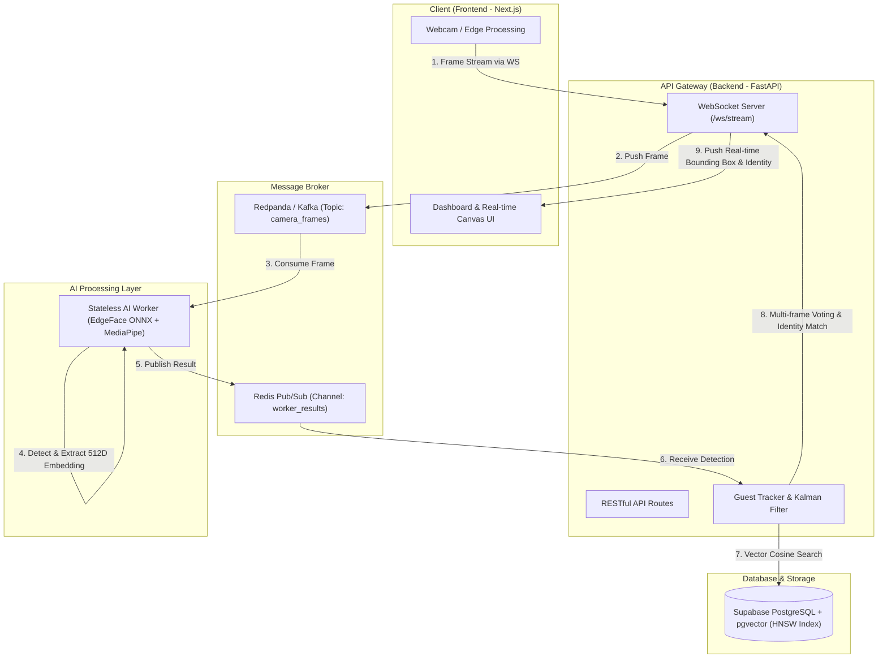

# GIẢI THÍCH CHI TIẾT DỰ ÁN FRONT DOOR AI (REAL-TIME FACE RECOGNITION SYSTEM)

Tài liệu này cung cấp cái nhìn toàn diện và chi tiết về cấu trúc thư mục, chức năng của từng file mã nguồn, cũng như sơ đồ luồng dữ liệu và sự liên kết giữa các thành phần trong dự án **Front Door AI**.

---

## 1. TỔNG QUAN KIẾN TRÚC HỆ THỐNG

Hệ thống được thiết kế theo kiến trúc phân tán (Distributed & Event-driven Architecture) hỗ trợ xử lý video nhận diện khuôn mặt theo thời gian thực (Real-time) với độ trễ thấp (Low-latency).

---

## 2. CHI TIẾT CẤU TRÚC THƯ MỤC VÀ TỪNG FILE MÃ NGUỒN

### 📁 1. Thư mục gốc (`/`)
- [README.md](file:///c:/SCHOOL/HK253/BigData/face-recognition-system/README.md): Tài liệu hướng dẫn sử dụng, cài đặt nhanh và tổng quan hệ thống.
- [docker-compose.yml](file:///c:/SCHOOL/HK253/BigData/face-recognition-system/docker-compose.yml): File đóng gói các dịch vụ (FastAPI, AI Worker, Redis, Redpanda) để chạy đồng bộ trên Docker.
- [.gitlab-ci.yml](file:///c:/SCHOOL/HK253/BigData/face-recognition-system/.gitlab-ci.yml): Cấu hình đường ống CI/CD của GitLab để tự động kiểm thử và deploy lên AWS EC2 khi merge code vào nhánh `main`.
- [nginx_api.conf](file:///c:/SCHOOL/HK253/BigData/face-recognition-system/nginx_api.conf): File cấu hình Reverse Proxy NGINX để định tuyến kết nối HTTP API và nâng cấp kết nối WebSocket.
- [deploy_env.bat](file:///c:/SCHOOL/HK253/BigData/face-recognition-system/deploy_env.bat) & [push-to-gitlab.ps1](file:///c:/SCHOOL/HK253/BigData/face-recognition-system/push-to-gitlab.ps1): Script tự động hóa công đoạn đóng gói và đẩy code trên Windows.

---

### 📁 2. Thư mục Backend (`backend/`)
Chứa toàn bộ mã nguồn xử lý logic máy chủ, thuật toán AI, cơ sở dữ liệu và API.

- [run.py](file:///c:/SCHOOL/HK253/BigData/face-recognition-system/backend/run.py): Point-of-entry để khởi động máy chủ Uvicorn ASGI chạy Backend ở cổng `8000`.
- [asgi.py](file:///c:/SCHOOL/HK253/BigData/face-recognition-system/backend/asgi.py): Khởi tạo ứng dụng FastAPI (`app`), thiết lập Middleware CORS cho phép Frontend truy cập, khởi tạo kết nối cơ sở dữ liệu và đường ống gửi tin Kafka/Redpanda (`lifespan`).
- [config.py](file:///c:/SCHOOL/HK253/BigData/face-recognition-system/backend/config.py): Nơi nạp các biến môi trường từ `.env` (như thông tin kết nối Supabase, Redis URL, Kafka Bootstrap Server, cài đặt mặc định).
- [db_config.py](file:///c:/SCHOOL/HK253/BigData/face-recognition-system/backend/db_config.py): Quản lý cấu hình chuỗi kết nối và thông số truy vấn tới cơ sở dữ liệu PostgreSQL.
- [Dockerfile](file:///c:/SCHOOL/HK253/BigData/face-recognition-system/backend/Dockerfile): File hướng dẫn tạo Docker Container Image cho phân hệ Backend.

#### 📂 `backend/app/`
- [ai_worker.py](file:///c:/SCHOOL/HK253/BigData/face-recognition-system/backend/app/ai_worker.py): **Tiến trình AI Worker độc lập (Stateless Worker)**. Tiến trình này lắng nghe các khung hình từ Redpanda queue (`camera_frames`), thực hiện:
  1. Đọc và giải mã hình ảnh (OpenCV).
  2. Phát hiện khuôn mặt (MediaPipe Face Landmarker).
  3. Trích xuất vector đặc trưng 512 chiều (EdgeFace ONNX Model).
  4. Đẩy kết quả thu được về kênh Redis Pub/Sub `worker_results_{connection_id}`.
- [init_redpanda.py](file:///c:/SCHOOL/HK253/BigData/face-recognition-system/backend/app/init_redpanda.py): Script khởi tạo Topic `camera_frames` trên Redpanda khi khởi động hệ thống.

##### 📂 `backend/app/api/`
- [routes.py](file:///c:/SCHOOL/HK253/BigData/face-recognition-system/backend/app/api/routes.py): File chứa toàn bộ các API Endpoints và cơ chế **Xác thực JWT RS256 Stateless**:
  - WebSocket `/ws/stream/{camera_id}`: Tiếp nhận luồng video realtime từ camera client và gửi trả kết quả nhận diện.
  - Customer API: CRUD khách hàng (`/api/customers`), tải ảnh khuôn mặt mẫu.
  - History API: Đọc nhật ký lịch sử nhận diện (`/api/history`).
  - Report API: Lấy số liệu báo cáo thống kê khách ghé thăm (`/api/reports`).
  - Settings API: Cập nhật thông số thuật toán realtime (`/api/settings`).

##### 📂 `backend/app/core/`
- [guest_tracking.py](file:///c:/SCHOOL/HK253/BigData/face-recognition-system/backend/app/core/guest_tracking.py): **Bộ não theo dõi và chốt định danh khách hàng**.
  - Áp dụng thuật toán **Kalman Filter** và IoU (Intersection over Union) để theo dõi tọa độ di chuyển của từng khuôn mặt qua từng khung hình (Tracking).
  - Áp dụng kỹ thuật **Multi-frame Voting**: Gom nhóm các vector trích xuất từ nhiều khung hình liên tiếp để tìm kiếm định danh chính xác nhất, tránh hiện tượng nhận diện nhầm khi khuôn mặt bị quay nghiêng hoặc mờ.
  - Quản lý vòng đời vết khách (Track Lifecycle): Cache thông tin khách ghé thăm để tối ưu tốc độ.
- [insight_embedding.py](file:///c:/SCHOOL/HK253/BigData/face-recognition-system/backend/app/core/insight_embedding.py): Module tương tác trực tiếp với các mô hình AI ONNX.
  - Đánh giá chất lượng ảnh (độ phân giải, độ sáng, độ nhòe chuyển động).
  - Thực hiện căn chỉnh khuôn mặt (Face Alignment) dựa trên các mốc mắt/mũi/miệng (Landmarks).
  - Chạy mô hình EdgeFace ONNX để tạo ra Embedding 512 float values.
- [settings.py](file:///c:/SCHOOL/HK253/BigData/face-recognition-system/backend/app/core/settings.py): Quản lý lưu trữ và đọc các thông số cấu hình hệ thống (ví dụ: ngưỡng nhận diện Cosine threshold, số lượng frame bỏ qua...).

##### 📂 `backend/app/db/`
- [connection.py](file:///c:/SCHOOL/HK253/BigData/face-recognition-system/backend/app/db/connection.py): Khởi tạo connection pool tới Supabase/PostgreSQL, đăng ký adapter `pgvector.psycopg2` và cài đặt bảng cơ sở dữ liệu (`ensure_schema`).
- [vector_search.py](file:///c:/SCHOOL/HK253/BigData/face-recognition-system/backend/app/db/vector_search.py): Xử lý truy vấn độ tương đồng Cosine giữa Embedding bằng **Native pgvector Parameter Binding** (truyền tham số mảng NumPy nhị phân) với danh sách khuôn mặt trong CSDL thông qua mở rộng `pgvector` và chỉ mục **HNSW Index**.
- [seed_data.py](file:///c:/SCHOOL/HK253/BigData/face-recognition-system/backend/app/db/seed_data.py): Tạo dữ liệu khởi tạo ban đầu (Tài khoản Administrator mặc định, dữ liệu mẫu).

##### 📂 `backend/app/utils/`
- [download_models.py](file:///c:/SCHOOL/HK253/BigData/face-recognition-system/backend/app/utils/download_models.py): Tự động tải các mô hình AI (`edgeface_s_gamma_05.onnx`, `face_landmarker.task`, `minifasnet_v2.onnx`) nếu chưa có sẵn ở máy local.
- [shared_frame.py](file:///c:/SCHOOL/HK253/BigData/face-recognition-system/backend/app/utils/shared_frame.py): Quản lý việc lưu trữ hình ảnh cắt khuôn mặt tạm thời.
- [logger.py](file:///c:/SCHOOL/HK253/BigData/face-recognition-system/backend/app/utils/logger.py): Định dạng và xuất nhật ký hoạt động hệ thống.

#### 📂 `backend/models/`
Chứa các tập tin trọng số mô hình AI đã được đóng gói dưới dạng ONNX/Task:
- `edgeface_s_gamma_05.onnx`: Mô hình trích xuất embedding khuôn mặt mỏng nhẹ, tối ưu cho CPU.
- `face_landmarker.task`: Mô hình xác định mốc khuôn mặt MediaPipe.
- `minifasnet_v2.onnx`: Mô hình chống giả mạo khuôn mặt (Anti-spoofing / Liveness detection).
- `adaface_ir18.onnx`, `ghostface_int8.onnx`: Các mô hình trích xuất embedding thử nghiệm bổ trợ.

---

### 📁 3. Thư mục Frontend (`frontend/`)
Ứng dụng giao diện người dùng xây dựng trên nền tảng **Next.js 14 (App Router)** và **Tailwind CSS**.

- [package.json](file:///c:/SCHOOL/HK253/BigData/face-recognition-system/frontend/package.json): Khai báo danh sách các thư viện mã nguồn mở và lệnh chạy npm.
- [next.config.js](file:///c:/SCHOOL/HK253/BigData/face-recognition-system/frontend/next.config.js): File cấu hình Next.js.
- [tailwind.config.js](file:///c:/SCHOOL/HK253/BigData/face-recognition-system/frontend/tailwind.config.js): Cấu hình bộ màu sắc, font chữ và phong cách giao diện Tailwind.

#### 📂 `frontend/src/app/`
- [page.jsx](file:///c:/SCHOOL/HK253/BigData/face-recognition-system/frontend/src/app/page.jsx): Dashboard tổng quan, hiển thị lưu lượng khách trong ngày, biểu đồ thống kê và thông báo realtime.
- [camera/page.jsx](file:///c:/SCHOOL/HK253/BigData/face-recognition-system/frontend/src/app/camera/page.jsx): Giao diện giám sát Camera chính. Thực hiện mở webcam, gửi dữ liệu hình ảnh qua WebSocket tới Backend, và vẽ các hộp nhận diện (Bounding Box) màu sắc lên Canvas trùng khớp với khuôn mặt.
- [customers/page.jsx](file:///c:/SCHOOL/HK253/BigData/face-recognition-system/frontend/src/app/customers/page.jsx): Màn hình quản lý thông tin khách hàng, cho phép đăng ký khuôn mặt mới hoặc cập nhật thông tin cá nhân.
- [history/page.jsx](file:///c:/SCHOOL/HK253/BigData/face-recognition-system/frontend/src/app/history/page.jsx): Xem danh sách nhật ký các lượt khách đã xuất hiện trước camera.
- [reports/page.jsx](file:///c:/SCHOOL/HK253/BigData/face-recognition-system/frontend/src/app/reports/page.jsx): Báo cáo chi tiết và xuất thống kê theo khoảng thời gian.
- [settings/page.jsx](file:///c:/SCHOOL/HK253/BigData/face-recognition-system/frontend/src/app/settings/page.jsx): Trang điều chỉnh cài đặt hệ thống (ngưỡng nhận diện, chế độ camera...).
- [login/page.jsx](file:///c:/SCHOOL/HK253/BigData/face-recognition-system/frontend/src/app/login/page.jsx): Trang đăng nhập quản trị viên.

#### 📂 `frontend/src/services/` & `frontend/src/components/`
- `websocket.js`: Quản lý việc khởi tạo, duy trì kết nối WebSocket và tự động kết nối lại khi mất mạng.
- `api.js`: Quản lý các cuộc gọi HTTP RESTful API (Axios / Fetch) tới Backend.
- `components/`: Chứa các thành phần UI dùng chung như Thanh điều hướng (Sidebar, Navbar), Modal, Thẻ thông báo (Notification toast).

---

### 📁 4. Thư mục Tài liệu & Script hỗ trợ (`docs/`, `scripts/`)
- 📂 `docs/`:
  - [system_architecture.md](file:///c:/SCHOOL/HK253/BigData/face-recognition-system/docs/system_architecture.md): Sơ đồ chi tiết kiến trúc tổng thể.
  - [ai_pipeline.md](file:///c:/SCHOOL/HK253/BigData/face-recognition-system/docs/ai_pipeline.md): Chi tiết thuật toán AI & Kalman Filter.
  - [database_schema.md](file:///c:/SCHOOL/HK253/BigData/face-recognition-system/docs/database_schema.md): Mô tả cấu trúc các bảng CSDL PostgreSQL.
  - [frontend_architecture.md](file:///c:/SCHOOL/HK253/BigData/face-recognition-system/docs/frontend_architecture.md): Cấu trúc ứng dụng Next.js.
  - [api_reference.md](file:///c:/SCHOOL/HK253/BigData/face-recognition-system/docs/api_reference.md): Mô tả danh sách API và giao thức WebSocket.
  - [maintenance_guide.md](file:///c:/SCHOOL/HK253/BigData/face-recognition-system/docs/maintenance_guide.md): Hướng dẫn vận hành và khắc phục sự cố.
- 📂 `scripts/`:
  - [setup-ec2.sh](file:///c:/SCHOOL/HK253/BigData/face-recognition-system/scripts/setup-ec2.sh): Script cài đặt môi trường tự động trên máy chủ AWS EC2 (Docker, Nginx, SSL).

---

## 3. SỰ LIÊN KẾT VÀ LUỒNG HOẠT ĐỘNG (DATA FLOW & INTERACTIONS)

### 🔄 Quy trình xử lý nhận diện khuôn mặt Real-time:

1. **Khởi tạo kết nối**:
   - Trình duyệt mở [camera/page.jsx](file:///c:/SCHOOL/HK253/BigData/face-recognition-system/frontend/src/app/camera/page.jsx), thiết lập kết nối WebSocket với Backend API tại URI `ws://localhost:8000/ws/stream/default_cam`.

2. **Truyền tải khung hình (Stream Frames)**:
   - Frontend capture khung hình từ webcam, mã hóa dưới dạng Binary/Base64 và gửi liên tục qua kết nối WebSocket.

3. **Hàng đợi thông điệp (Message Streaming)**:
   - Backend FastAPI [routes.py](file:///c:/SCHOOL/HK253/BigData/face-recognition-system/backend/app/api/routes.py) tiếp nhận frame và đẩy vào Topic `camera_frames` trên **Redpanda/Kafka**.

4. **Xử lý AI song song (Asynchronous AI Worker)**:
   - Một hoặc nhiều tiến trình [ai_worker.py](file:///c:/SCHOOL/HK253/BigData/face-recognition-system/backend/app/ai_worker.py) đọc frame từ Redpanda.
   - Trích xuất vị trí khuôn mặt và tính toán chuỗi Vector 512D bằng mô hình `edgeface_s_gamma_05.onnx`.
   - Kết quả thu được lập tức phát lên kênh Redis Pub/Sub `worker_results_{connection_id}`.

5. **Theo dõi vị trí & Tìm kiếm vector (Tracking & Search)**:
   - FastAPI lắng nghe Redis Pub/Sub, chuyển dữ liệu khuôn mặt vào [guest_tracking.py](file:///c:/SCHOOL/HK253/BigData/face-recognition-system/backend/app/core/guest_tracking.py).
   - [guest_tracking.py](file:///c:/SCHOOL/HK253/BigData/face-recognition-system/backend/app/core/guest_tracking.py) gọi [vector_search.py](file:///c:/SCHOOL/HK253/BigData/face-recognition-system/backend/app/db/vector_search.py) thực hiện truy vấn Cosine Similarity trên bảng khách hàng ở Supabase Database.
   - Áp dụng **Multi-frame Voting** qua nhiều frame liên tiếp để kết luận danh tính (Khách quen / VIP / Khách lạ mới).

6. **Phản hồi thời gian thực (Realtime Feedback)**:
   - FastAPI trả thông điệp JSON chứa tọa độ `[x1, y1, x2, y2]`, tên khách hàng, loại khách hàng về Frontend qua kết nối WebSocket.
   - Frontend hiển thị khung viền xanh/vàng/đỏ bao quanh khuôn mặt và hiển thị popup chào mừng khách trên giao diện Dashboard.
