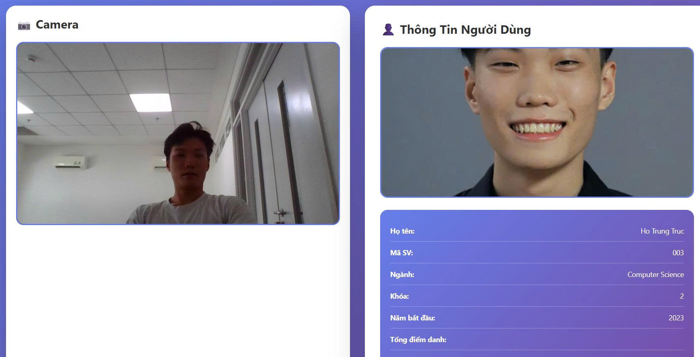

# Smart Front-door AI

A restaurant entrance camera system that recognizes and identifies customers in real time. The stack uses a Flask backend (MJPEG streaming, SQLite) and a Next.js frontend.



## Features

- Real-time face detection and matching via embeddings
- Customer profiles stored in SQLite
- Decoupled React UI for future dashboards
- Stable MJPEG stream for low-latency video

## Model

- Detection: MediaPipe FaceLandmarker (`backend/models/face_landmarker.task`)
- Recognition / embedding: MobileFaceNet ONNX int8 (`backend/models/mobilefacenet_int8.onnx`)
- The backend uses only these two runtime models; `w600k_mbf.onnx` is kept only as the float source model for regenerating the int8 embedding file

## Project structure

```
face-recognition-system/
├── backend/
│   ├── app/
│   │   ├── api/              # API routes + streaming
│   │   ├── core/             # Face recognition logic
│   │   ├── db/               # SQLite access
│   │   └── utils/            # Encodings + model downloader
│   ├── data/
│   │   ├── encodings/
│   │   ├── images/
│   │   └── face_attendance.db
│   ├── models/               # ONNX models
│   ├── config.py
│   ├── requirements.txt
│   └── run.py
├── frontend/
│   ├── src/
│   │   ├── components/
│   │   ├── hooks/
│   │   ├── pages/
│   │   └── services/
│   ├── public/
│   ├── package.json
│   └── tailwind.config.js
└── README.md
```

## Quick start (Windows)

### 1) Backend

```bash
python -m venv .venv
\.venv\Scripts\activate
pip install -r backend\requirements.txt
```

Download models and prepare data:

```bash
cd backend
python -m app.utils.download_models
python -m app.db.seed_data
python -m app.utils.encodings
```

`download_models` sẽ tải model nền `w600k_mbf.onnx` và tự sinh bản embedding int8 `mobilefacenet_int8.onnx` để backend dùng cho trích xuất đặc trưng.

Run the backend:

```bash
python backend/run.py
```

Backend runs at `http://localhost:5000`.

### 2) Frontend

Open a new terminal:

```bash
cd frontend
npm install #Once time
npm run dev
```

Frontend runs at `http://localhost:3000`.

By default the frontend calls `http://localhost:5000`. To change it, create `frontend\.env.local`:

```text
NEXT_PUBLIC_API_BASE_URL=http://localhost:5000
```

Then restart `npm run dev`.

## API endpoints

- `GET /video_feed`: MJPEG stream from the camera
- `GET /api/customer_info`: current customer profile
- `POST /api/check_in`: check-in the current customer

## Preparing customer photos

1. Put images in: `backend/data/images/`
2. File name: `{customer_id}.jpg` or `.png`
3. After adding images, re-generate encodings:

```bash
cd backend
python -m app.utils.encodings
```

## Quick configuration

- Camera index, similarity threshold, and cooldown live in [backend/config.py](backend/config.py)
- To change backend port, edit `host`/`port` in [backend/run.py](backend/run.py)

## Troubleshooting

- **Cannot access camera**: close other apps using the webcam
- **No customer detected**: run `python -m app.utils.encodings`
- **Model error**: ensure `.onnx` files exist in `backend/models/`
