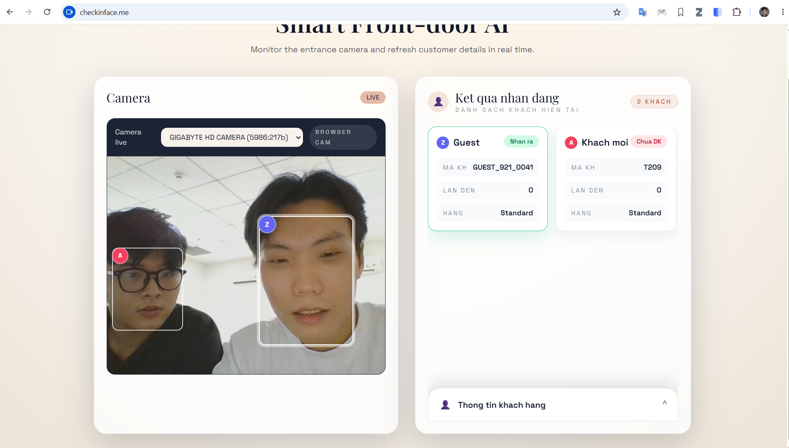

 # Face Recognition — Front Door AI

 Phiên bản hiện tại: tài liệu cập nhật cho kiến trúc và tính năng đang triển khai (backend FastAPI + frontend Next.js).

 Mục tiêu: hệ thống nhận diện khuôn mặt thời gian thực dùng camera trình duyệt (frontend) để gửi frame lên backend xử lý, hiển thị nhiều khách cùng lúc, cho phép chỉnh sửa hồ sơ khách hàng và đồng bộ hiển thị badge track giữa camera và ô khách.

<p align="center">
  
</p>

 ---

 ## Tính năng chính

 - Ghi nhận và phân biệt nhiều khách cùng lúc (đa ô / overview)
 - Camera chạy trên trình duyệt (`getUserMedia`) — backend chỉ nhận frame để xử lý
 - Đồng bộ badge/track giữa overlay camera và ô thông tin khách (ký hiệu A/B/C...)
 - Chỉnh sửa thông tin khách ngay trên giao diện: `name`, `phone`, `note` (PUT `/api/customer_profile`)
 - Cơ sở dữ liệu SQLite đơn giản lưu profile, lượt ghé (`visit_count`) và `note`
 - Cấu hình dễ chỉnh (backend `config.py`, frontend env)

 ## Kiến trúc nhanh

 - Backend: FastAPI + Uvicorn (ASGI)
 - Frontend: Next.js (React) + Tailwind CSS
 - Models: MediaPipe face detection + MobileFaceNet ONNX embedding
 - DB: SQLite (file trong `backend/data/`)
 - Giao tiếp: frontend gọi API backend (base URL qua `NEXT_PUBLIC_API_BASE_URL`)

 ## API chính (tóm tắt)

 - `GET /test` — kiểm tra backend chạy
 - `POST /api/process_frame` — (nội bộ) backend nhận frame (base64 JPEG hoặc binary) để phát hiện & ghi nhận
 - `GET /api/customers_overview` — trả về danh sách `customers` hiện tại + `frame_size` để frontend vẽ overlay
   - `customers[]` trường quan trọng: `id`, `name`, `phone`, `note`, `tile_id`, `track_id`, `detected` (bool), `visit_count`, `last_visit`, `bbox` (x,y,w,h)
   - `frame_size`: `{width, height}` — dùng để scale bbox từ backend sang canvas frontend
 - `PUT /api/customer_profile` — tạo / cập nhật profile khách
   - Payload: `{ "id": "KH001" | null, "source_id": <optional>, "name": "Tên khách", "phone": "0123456", "note": "..." }`
   - Nếu là khách mới (không có `id` cố định) API sẽ gán `KH` tiếp theo (ví dụ `KH001` → `KH002`)

 Ghi chú: một số endpoint check-in cũ vẫn tồn tại trên server nhưng UI đã loại bỏ nút check-in nếu không dùng.

 ## Chạy nhanh (local)

 Yêu cầu: Python 3.10+, Node.js 18+.

 1) Backend

 ```powershell
 python -m venv .venv
 .venv\Scripts\Activate.ps1
 pip install -r backend/requirements.txt
 ```

 Tải model và chuẩn bị dữ liệu (tự động nếu cần):

 ```powershell
 cd backend
 python -m app.utils.download_models
 python -m app.db.seed_data
 python -m app.utils.encodings
 ```

 Chạy backend:

 ```powershell
 python backend/run.py
 ```

 Mặc định backend lắng nghe `http://localhost:8000`.

 2) Frontend

 ```bash
 cd frontend
 npm install
 npm run dev
 ```

 Mặc định frontend chạy `http://localhost:3000` và gọi backend theo `NEXT_PUBLIC_API_BASE_URL`.

 Tạo file `frontend/.env.local` nếu cần:

 ```text
 NEXT_PUBLIC_API_BASE_URL=http://localhost:8000
 ```

 ## Cấu hình quan trọng

 - Backend: [backend/config.py](backend/config.py)
   - `FRAME_WIDTH`, `FRAME_HEIGHT`, `PROCESS_EVERY_N_FRAMES`, `EMBEDDING_EVERY_N_DETECT`, `CHECKIN_COOLDOWN_SECONDS`, `CUSTOMER_INFO_CACHE_TTL_MS`
 - Frontend: `NEXT_PUBLIC_API_BASE_URL`
 - CORS: khi chạy dev, cho phép `http://localhost:3000` và `http://localhost:3001` (nếu cần)

 ## Triển khai trên EC2 (tóm tắt)

 1. Trên server (Ubuntu):

 ```bash
 git clone <repo>
 cd face-recognition-system/backend
 python -m venv .venv
 source .venv/bin/activate
 pip install -r requirements.txt
 ```

 2. Pull thay đổi và restart (ví dụ):

 ```bash
 cd /home/ubuntu/face-recognition-system
 git pull origin main
 # restart backend (vd. run.sh hoặc systemd). ví dụ nohup:
 nohup .venv/bin/uvicorn app.asgi:app --host 0.0.0.0 --port 80 &
 ```

 3. Kiểm tra:

 ```bash
 curl http://127.0.0.1/test
 curl http://127.0.0.1/api/customers_overview
 ```

 Ghi chú: SSH key (PEM) và quyền cần chuẩn bị. CORS phải cấu hình nếu frontend host khác domain.

 ## Cấu trúc DB (tóm tắt)

 - Bảng `customers` (SQLite): `id TEXT, name TEXT, phone TEXT, note TEXT, visit_count INTEGER, last_visit TEXT, ...`
 - Migrations: `backend/app/db/connection.py` có logic nâng cấp schema để thêm cột `note` khi cần.

 ## Kiểm tra nhanh (smoke test)

 - `GET /test` → trả về `{"status":"ok"}`
 - `GET /api/customers_overview` → trả về `customers` array và `frame_size`
 - Ghi nhận: frontend sẽ hiển thị overlay theo `bbox` và `frame_size`

 ## Ghi chú phát triển & tối ưu

 - Đã tách capture ra client (giảm lỗi camera khi chạy trên EC2)
 - Tối ưu tiếp theo: giảm upload frequency, cache profile, schedule embedding, chuyển sang upload binary frames
 - Xem các biến cấu hình trong `backend/config.py` để tinh chỉnh hiệu năng

 ---

 Nếu bạn muốn, tôi có thể: commit & push thay đổi README này lên GitLab và/hoặc deploy lên EC2. Bạn muốn tôi làm tiếp theo không?


