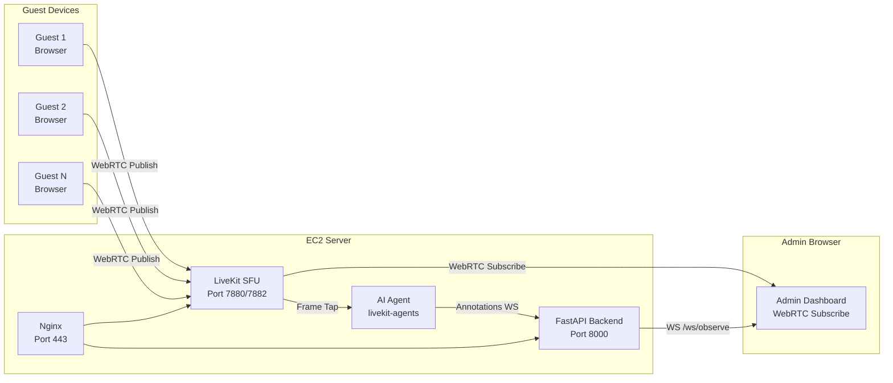

# Tích hợp LiveKit SFU vào hệ thống Face Recognition

## Bối cảnh

Hiện tại hệ thống truyền video bằng **JPEG snapshot polling** (Guest gửi JPEG qua WebSocket → Backend lưu → Admin poll JPEG qua HTTP). Kết quả: **1-3 FPS, lag 500-1000ms**, không scale được khi có nhiều camera.

**Mục tiêu**: Chuyển sang kiến trúc **SFU (Selective Forwarding Unit)** với LiveKit để đạt **15-30 FPS, lag < 150ms**, hỗ trợ 20+ camera đồng thời.

## Kiến trúc mới



### So sánh với kiến trúc cũ

| | Kiến trúc cũ (JPEG Polling) | Kiến trúc mới (LiveKit SFU) |
|---|---|---|
| **Luồng video** | Guest → WS JPEG → Backend → HTTP JPEG → Admin | Guest → WebRTC → LiveKit → WebRTC → Admin |
| **FPS** | 1-3 fps | 15-30 fps |
| **Độ trễ** | 500-1000ms | 50-150ms |
| **AI Processing** | Backend decode JPEG trực tiếp | AI Agent subscribe LiveKit track → extract frame |
| **Bandwidth** | Mỗi frame = 1 HTTP request (50KB) | VP8/H264 stream liên tục (~500Kbps/camera) |
| **Scale** | 2-3 camera max | 20+ camera |

---

## Tại sao chọn LiveKit?

| SFU | Ngôn ngữ | Docker | JS SDK | Python SDK | AI Agents | Ghi chú |
|-----|----------|--------|--------|------------|-----------|---------|
| **LiveKit** ✅ | Go | ✅ Official | ✅ `livekit-client` | ✅ `livekit-agents` | ✅ Built-in | Tốt nhất cho dự án này |
| mediasoup | Node.js | ❌ Manual | ✅ | ❌ | ❌ | Phải tự viết Python bridge |
| Janus | C | ✅ | ⚠️ Complex | ❌ | ❌ | Quá phức tạp |
| Pion/ion-sfu | Go | ✅ | ⚠️ Basic | ❌ | ❌ | Thiếu SDK |

---

## Proposed Changes

### Phase 1: Thêm LiveKit Server vào Docker Compose

#### [MODIFY] [docker-compose.yml](file:///c:/SCHOOL/HK253/BigData/face-recognition-system/docker-compose.yml)

Thêm LiveKit server + Redis:

```yaml
services:
  livekit:
    image: livekit/livekit-server:latest
    container_name: faceai_livekit
    restart: unless-stopped
    ports:
      - "7880:7880"   # Signal (HTTP/WS)
      - "7882:7882/udp" # Media (WebRTC UDP)
    volumes:
      - ./livekit.yaml:/livekit.yaml
    command: --config /livekit.yaml

  redis:
    image: redis:7-alpine
    container_name: faceai_redis
    restart: unless-stopped
    mem_limit: 64m
```

#### [NEW] livekit.yaml

```yaml
port: 7880
rtc:
  port_range_start: 7882
  port_range_end: 7882
  use_external_ip: true
redis:
  address: redis:6379
keys:
  # API Key & Secret (dùng để tạo JWT token)
  FACEAI_API_KEY: <generated-secret>
logging:
  level: info
```

> [!IMPORTANT]
> **Yêu cầu EC2 Security Group**: Mở thêm port **7882/UDP** cho WebRTC media traffic. Port 7880 có thể proxy qua Nginx.

---

### Phase 2: Frontend — Guest Device (Publisher)

#### [MODIFY] [useCamera.js](file:///c:/SCHOOL/HK253/BigData/face-recognition-system/frontend/src/hooks/useCamera.js)

Thay thế logic WebSocket JPEG bằng LiveKit Room:

```javascript
import { Room, RoomEvent, Track } from 'livekit-client';

// Guest joins a LiveKit room and publishes webcam
const room = new Room({ adaptiveStream: true, dynacast: true });
await room.connect(LIVEKIT_URL, accessToken);
await room.localParticipant.setCameraEnabled(true);
```

**Quan trọng**: Vẫn giữ WebSocket JPEG song song trong giai đoạn chuyển tiếp (dual-path) để AI pipeline không bị gián đoạn.

#### [NEW] hooks/useLiveKitRoom.js

Hook mới quản lý kết nối LiveKit Room:
- Tạo Room, connect với token
- Publish webcam track
- Expose room state (connected, participants, tracks)

---

### Phase 3: Frontend — Admin (Subscriber/Viewer)

#### [MODIFY] [CameraViewer.jsx](file:///c:/SCHOOL/HK253/BigData/face-recognition-system/frontend/src/components/CameraViewer.jsx)

Thay thế JPEG polling bằng WebRTC subscribe:

```javascript
// Admin subscribes to Guest's video track via LiveKit
room.on(RoomEvent.TrackSubscribed, (track, publication, participant) => {
  if (track.kind === Track.Kind.Video) {
    const element = track.attach(); // Returns <video> element
    containerRef.current.appendChild(element);
  }
});
```

**Kết quả**: Video 30fps, lag < 150ms, không cần HTTP polling.

---

### Phase 4: Backend — AI Agent (Frame Processor)

#### [NEW] backend/ai_agent.py

Sử dụng `livekit-agents` Python framework:

```python
from livekit import rtc
from livekit.agents import JobContext, WorkerOptions, cli

async def process_video_track(track: rtc.Track, ctx: JobContext):
    video_stream = rtc.VideoStream(track)
    async for frame_event in video_stream:
        # Convert LiveKit frame → numpy array (OpenCV compatible)
        buf = frame_event.frame.convert(rtc.VideoBufferType.RGB24)
        img = np.frombuffer(buf.data, dtype=np.uint8)
        img = img.reshape((buf.height, buf.width, 3))
        frame_bgr = cv2.cvtColor(img, cv2.COLOR_RGB2BGR)
        
        # Run face detection + recognition (existing pipeline)
        detections = embedder.detect(frame_bgr)
        # ... process and send annotations via data channel ...

async def entrypoint(ctx: JobContext):
    await ctx.connect()
    
    @ctx.room.on("track_subscribed")
    def on_track(track, publication, participant):
        if track.kind == rtc.TrackKind.KIND_VIDEO:
            asyncio.create_task(process_video_track(track, ctx))
```

> [!NOTE]
> AI Agent chạy như một **container Docker riêng**, join vào mỗi LiveKit room như một "participant ẩn" và xử lý video frame.

---

### Phase 5: Token Server

#### [MODIFY] [routes.py](file:///c:/SCHOOL/HK253/BigData/face-recognition-system/backend/app/api/routes.py)

Thêm endpoint tạo LiveKit access token:

```python
from livekit.api import AccessToken, VideoGrant

@router.post("/api/livekit/token")
async def create_livekit_token(request: Request):
    payload = await request.json()
    room_name = payload.get("room", "default")
    identity = payload.get("identity", f"user-{secrets.token_hex(4)}")
    
    token = AccessToken(LIVEKIT_API_KEY, LIVEKIT_API_SECRET)
    token.identity = identity
    token.add_grant(VideoGrant(
        room_join=True,
        room=room_name,
        can_publish=True,
        can_subscribe=True,
    ))
    
    return {"token": token.to_jwt()}
```

---

## Chiến lược triển khai (Migration Strategy)

### Giai đoạn 1: Dual-Path (An toàn nhất)
```
Guest → WebRTC → LiveKit → Admin (xem video mượt)
Guest → WS JPEG → Backend AI (nhận diện khuôn mặt, không thay đổi)
```
- Admin xem video qua WebRTC (mượt 30fps)
- AI vẫn nhận frame qua WebSocket JPEG cũ (ổn định)
- **Ưu điểm**: Không phá vỡ pipeline AI hiện tại
- **Nhược điểm**: Guest gửi video 2 đường (tốn bandwidth đôi)

### Giai đoạn 2: Full LiveKit
```
Guest → WebRTC → LiveKit → Admin (xem video)
                         → AI Agent (nhận diện)
```
- AI Agent subscribe LiveKit track, không cần WebSocket JPEG nữa
- Xóa bỏ hoàn toàn code JPEG polling
- **Ưu điểm**: Sạch sẽ, tối ưu bandwidth
- **Nhược điểm**: Cần viết lại AI pipeline dùng livekit-agents

> [!WARNING]
> **Khuyến nghị**: Làm **Giai đoạn 1 trước** vì nó cho kết quả ngay lập tức (video mượt cho Admin) mà không ảnh hưởng đến pipeline nhận diện AI đang hoạt động tốt.

---

## Tổng hợp files cần thay đổi

| File | Hành động | Phase |
|------|-----------|-------|
| `docker-compose.yml` | MODIFY — thêm LiveKit + Redis | 1 |
| `livekit.yaml` | NEW — cấu hình LiveKit server | 1 |
| `nginx/default.conf` | MODIFY — proxy LiveKit qua HTTPS | 1 |
| `frontend/src/hooks/useLiveKitRoom.js` | NEW — LiveKit Room hook | 2 |
| `frontend/src/hooks/useCamera.js` | MODIFY — thêm dual-path publish | 2 |
| `frontend/src/components/CameraViewer.jsx` | MODIFY — WebRTC subscribe thay JPEG polling | 3 |
| `frontend/src/app/camera/page.jsx` | MODIFY — dùng LiveKit rooms thay sessions | 3 |
| `backend/app/api/routes.py` | MODIFY — thêm token endpoint | 5 |
| `backend/ai_agent.py` | NEW — LiveKit Agents video processor | 4 (Phase 2) |
| `frontend/package.json` | MODIFY — thêm `livekit-client` dependency | 2 |
| `backend/requirements-prod.txt` | MODIFY — thêm `livekit`, `livekit-agents` | 4 |

---

## Yêu cầu hạ tầng

> [!CAUTION]
> **EC2 hiện tại (t3.micro)** có thể gặp khó khăn:
> - Disk: 89.1% đã dùng (10.58GB) — LiveKit image ~50MB, Redis ~10MB
> - Memory: 57% — LiveKit cần thêm ~128MB RAM, Redis ~32MB
> - **Khuyến nghị**: Nâng lên **t3.small** (2GB RAM) hoặc dọn dẹp disk trước khi triển khai

### Ports cần mở trên Security Group
| Port | Protocol | Mục đích |
|------|----------|----------|
| 7880 | TCP | LiveKit Signal (WebSocket) |
| 7882 | UDP | LiveKit Media (WebRTC) |
| 443 | TCP | HTTPS (đã có) |

## Open Questions

> [!IMPORTANT]
> **Q1**: Bạn muốn bắt đầu với **Giai đoạn 1 (Dual-Path)** hay nhảy thẳng vào **Giai đoạn 2 (Full LiveKit)**?
> - Giai đoạn 1 an toàn hơn, triển khai nhanh hơn (~2-3 giờ)
> - Giai đoạn 2 sạch sẽ hơn nhưng rủi ro cao hơn (~1-2 ngày)

> [!IMPORTANT]
> **Q2**: EC2 hiện tại có thể nâng lên t3.small được không? Hay có giới hạn chi phí?

## Verification Plan

### Automated Tests
```bash
# Verify LiveKit server is running
curl http://localhost:7880
# Verify token generation
curl -X POST http://localhost:8000/api/livekit/token -d '{"room":"test"}'
```

### Manual Verification
1. Guest mở trang chủ → bật camera → video publish lên LiveKit room
2. Admin mở `/camera` → thấy video 30fps mượt mà qua WebRTC
3. AI vẫn nhận diện khuôn mặt bình thường (không bị gián đoạn)
4. Mở 3+ thiết bị Guest cùng lúc → Admin thấy tất cả, không lag
