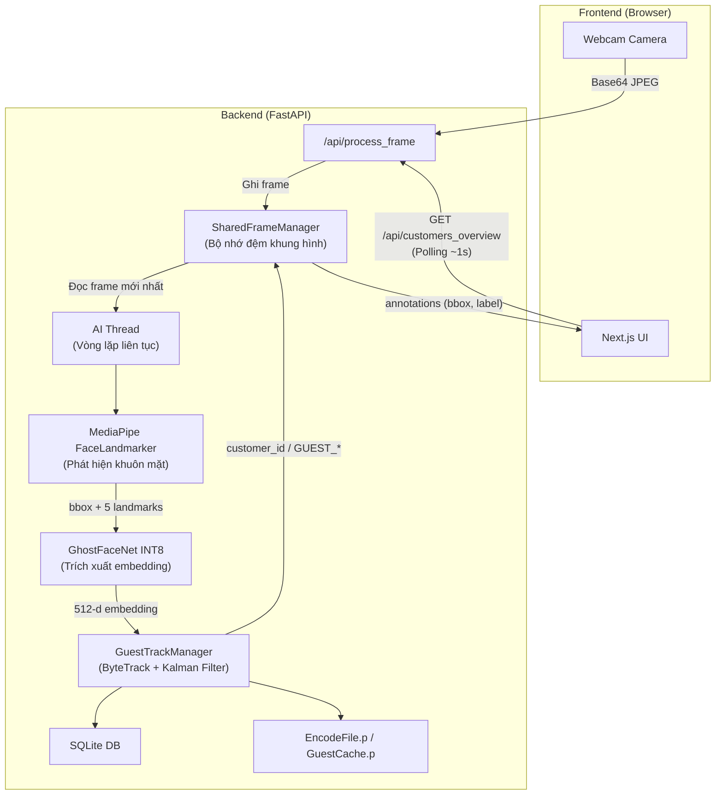
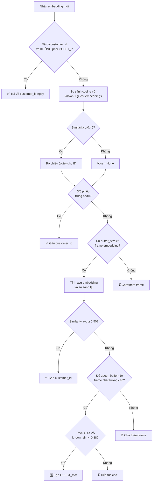

# 🔍 Phân Tích Logic Vận Hành Backend

## Kiến Trúc Tổng Quan



---

## Luồng Xử Lý Chi Tiết

### 1. Tiếp Nhận Frame — [asgi.py](file:///c:/SCHOOL/HK253/BigData/face-recognition-system/backend/asgi.py) + [routes.py](file:///c:/SCHOOL/HK253/BigData/face-recognition-system/backend/app/api/routes.py)

| Bước | Mô tả |
|------|-------|
| Frontend gửi frame | `POST /api/process_frame` với ảnh base64 |
| Backend giải mã | `_decode_frame_payload()` → `cv2.imdecode()` → numpy array BGR |
| Ghi vào bộ đệm | `SharedFrameManager.write_frame()` — copy vào buffer pre-allocated |

### 2. AI Thread — [routes.py#L162-L183](file:///c:/SCHOOL/HK253/BigData/face-recognition-system/backend/app/api/routes.py#L162-L183)

Một **daemon thread** chạy vòng lặp vô hạn:

```
while True:
    1. Kiểm tra frame mới (so sánh version)
    2. Nếu có frame mới → gọi _process_frame(frame)
    3. Nếu chưa có → sleep 50ms rồi kiểm tra lại
```

### 3. Phát Hiện Khuôn Mặt — [insight_embedding.py](file:///c:/SCHOOL/HK253/BigData/face-recognition-system/backend/app/core/insight_embedding.py)

| Thành phần | Chi tiết |
|------------|----------|
| **Mô hình** | MediaPipe Tasks API (`face_landmarker.task`) |
| **Đầu vào** | Ảnh RGB, gọi `detect_for_video()` |
| **Đầu ra** | Bounding box (x1,y1,x2,y2) + 5 landmarks + score |
| **NMS** | Loại bỏ bbox trùng lặp (threshold 0.4) |
| **Fallback** | MediaPipe Solutions → OpenCV Haar Cascade |

### 4. Trích Xuất Embedding — [insight_embedding.py#L326-L369](file:///c:/SCHOOL/HK253/BigData/face-recognition-system/backend/app/core/insight_embedding.py#L326-L369)

```
1. Dùng 5 landmarks → estimateAffinePartial2D → warpAffine (112×112)
2. Chuẩn hoá pixel: (pixel - 127.5) / 127.5
3. Đưa qua GhostFaceNet INT8 (ONNX) → vector 512 chiều
4. L2-normalize → embedding cuối cùng
```

### 5. Tracking — [guest_tracking.py](file:///c:/SCHOOL/HK253/BigData/face-recognition-system/backend/app/core/guest_tracking.py)

Thuật toán **ByteTrack** 2 bước:

```
Bước 1: Ghép track cũ ↔ detection điểm cao (score ≥ 0.6)
        → Hungarian Algorithm (linear_sum_assignment) trên ma trận IoU
        → Ngưỡng IoU ≥ 0.3 mới chấp nhận ghép

Bước 2: Track chưa ghép ↔ detection điểm thấp (0.3 ≤ score < 0.6)
        → Cùng thuật toán Hungarian

Bước 3: Detection mới (bbox ≥ 50px) → tạo Track mới

Bước 4: Track mất tín hiệu > 30 frame → xóa
```

Mỗi track có **Kalman Filter** riêng (`KalmanFilterCorner`) để dự đoán vị trí bbox kế tiếp, giúp ghép nối chính xác hơn khi khuôn mặt di chuyển.

### 6. Nhận Diện Khách — [guest_tracking.py#L284-L405](file:///c:/SCHOOL/HK253/BigData/face-recognition-system/backend/app/core/guest_tracking.py#L284-L405)



#### Các ngưỡng quan trọng hiện tại:

| Tham số | Giá trị | Ý nghĩa |
|---------|---------|---------|
| `SIMILARITY_THRESHOLD` | 0.50 | Ngưỡng cosine để xác nhận khách cũ (avg embedding) |
| Vote threshold | 0.45 | Ngưỡng cosine cho mỗi frame vote |
| Vote count | 3/5 | Số phiếu cần để kết luận |
| `GUEST_CREATION_BUFFER_SIZE` | 10 | Số frame chất lượng cao cần tích luỹ |
| `NEW_GUEST_DEBOUNCE_SECONDS` | 4s | Thời gian chờ tối thiểu trước khi tạo GUEST |
| `NEW_GUEST_DEBOUNCE_SIMILARITY` | 0.38 | Nếu giống ai đó > 0.38 → không tạo GUEST |
| `GUEST_MIN_FACE_BBOX_SIZE` | 100px | Kích thước bbox tối thiểu cho guest quality |
| `GUEST_MIN_DETECTION_SCORE` | 0.85 | Điểm phát hiện tối thiểu cho guest quality |
| `MIN_FACE_BBOX_SIZE` | 50px | Kích thước bbox tối thiểu chung |
| `MIN_DETECTION_SCORE` | 0.30 | Điểm phát hiện tối thiểu chung |

### 7. Auto-Merge Template

Khi khách cũ được nhận diện thành công qua voting (3/5), hệ thống tự động:
- Tính **avg embedding** của các frame chất lượng cao trong phiên này
- **Merge** vào face bank (`known_embeddings`) dưới cùng customer_id
- Giúp cải thiện nhận diện các lần sau (khi đeo kính, góc khác, v.v.)

### 8. Lưu Trữ Dữ Liệu

| File/DB | Chức năng |
|---------|-----------|
| `EncodeFile.p` | Pickle: `[embeddings[], ids[]]` — face bank khách đã đăng ký |
| `GuestCache.p` | Pickle: `[guest_embeddings[], guest_ids[]]` — face bank GUEST |
| `production.db` | SQLite: bảng `customers`, `customer_embeddings`, `orders`, ... |

---

## ⚠️ Điểm Yếu & Cơ Hội Cải Tiến

### 1. **Tốc độ nhận diện khách mới quá chậm**
- Phải chờ **10 frame chất lượng cao** + **4 giây debounce** → tổng cộng **6-8 giây** mới tạo GUEST
- Trong thời gian chờ, hiển thị `"T{x} buffering"` — trải nghiệm người dùng kém

### 2. **Không phân biệt được "Unknown" vs "Đang xử lý"**
- Hiện tại không có trạng thái `unknown` rõ ràng
- Bbox chỉ hiển thị `"T{x} buffering"` hoặc `"T{x} low quality"` — không rõ nghĩa

### 3. **Auto-Merge không kiểm soát được**
- Mỗi lần nhận diện thành công → thêm 1 embedding vào face bank
- Theo thời gian, face bank phình to → chậm dần
- Không có cơ chế giới hạn số template per customer

### 4. **Frontend polling thay vì streaming**
- Frontend gửi frame base64 + polling `/api/customers_overview` mỗi ~1s
- Overhead: encode JPEG → base64 → HTTP → decode → AI
- Latency tối thiểu = round-trip time + AI inference

### 5. **SharedFrameManager trả view, không copy**
- `read_frame()` trả về reference trực tiếp tới buffer
- Nếu camera thread ghi đè trong lúc AI đang xử lý → **data race** tiềm ẩn

### 6. **Không có cơ chế expire cho GUEST**
- GUEST_xxx được tạo và tồn tại vĩnh viễn trong DB + GuestCache.p
- Theo thời gian, số GUEST tăng vô hạn → chậm matching

---

## 🎯 Bạn muốn cải tiến gì?

Dựa trên ảnh chụp màn hình bạn gửi (đang hiển thị `GUEST_84_0008`), một số hướng cải tiến thiết thực:

1. **Giảm thời gian chờ tạo GUEST** (ví dụ: 5 frame + 2 giây thay vì 10 frame + 4 giây)
2. **Hiển thị trạng thái rõ ràng hơn** (Unknown → Analyzing → Guest/Customer)
3. **Giới hạn số template per customer** để tránh face bank phình to
4. **Thêm cơ chế expire/cleanup GUEST** cũ
5. **Tối ưu pipeline**: giảm overhead base64, xử lý batch
6. **Cải thiện độ chính xác nhận diện** (thay đổi model, thêm face alignment chuẩn hơn)

> [!IMPORTANT]
> Hãy cho tôi biết bạn muốn cải tiến **hướng nào** hoặc **vấn đề cụ thể nào** đang gặp phải, tôi sẽ lập kế hoạch chi tiết!
