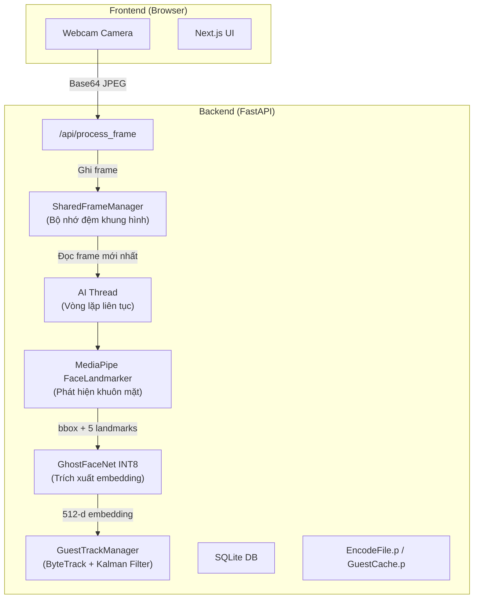

# 🔍 Phân Tích Logic Vận Hành Backend

## Kiến Trúc Tổng Quan



---

## 🐞 Phân Tích Lỗi BBox Nhận Diện Bị Tách Rời (Mirrored BBox Issue)

### 1. Hiện tượng lỗi (Symptom)
Khi tích hợp `useLocalFaceDetector` (MediaPipe JS) chạy trực tiếp trên Frontend để tạo BBox tracking mượt mà (viền xám), chúng ta gặp hiện tượng:
- BBox Local (màu xám) bám chuẩn xác vào khuôn mặt người dùng trên màn hình.
- BBox Recognition của Backend (có huy hiệu, ví dụ "A" hoặc "H") lại xuất hiện ở **vị trí đối xứng ngang (horizontally mirrored)** so với khuôn mặt.
- Kết quả là BBox bị tách làm 2, hệ thống không thể merge chúng lại với nhau.

### 2. Phân tích nguyên nhân gốc rễ (Root Cause)
Sự sai lệch này bắt nguồn từ **sự bất đồng bộ hệ tọa độ (Coordinate System Discrepancy)** giữa Frontend và Backend khi xử lý luồng video từ Front-facing Camera (Camera trước/Webcam):

1. **Local FaceDetector (Frontend):** 
   - MediaPipe JS (`@mediapipe/tasks-vision`) đọc dữ liệu trực tiếp từ thẻ `<video>`. 
   - Trong một số trình duyệt hoặc driver camera, luồng video raw từ "user-facing camera" có thể được hệ thống ngầm lật (mirror) để mang lại trải nghiệm "soi gương" cho người dùng, HOẶC bản thân MediaPipe tự động lật tọa độ `originX` theo chuẩn front-camera. Kết quả là tọa độ `left` của Local BBox hoàn toàn khớp với hình ảnh hiển thị trên UI.

2. **Canvas -> WebSocket (Backend Pipeline):**
   - Frontend dùng `canvas.drawImage(video)` để chụp khung hình gửi về Backend. Thao tác này chụp lại các pixel theo **hệ tọa độ thực tế (unmirrored)** của video stream gốc.
   - Backend nhận ảnh JPEG không bị lật, chạy AI model (MediaPipe Python / OpenCV) và trả về tọa độ `x1, y1, x2, y2`.
   - Vì ảnh gửi đi không bị lật, nhưng giao diện người dùng (UI) lại hiển thị theo hướng lật (soi gương), tọa độ trả về từ Backend khi áp lên UI sẽ bị ngược 100% theo trục ngang (Trái thành Phải, Phải thành Trái).

=> Trạng thái cũ (trước khi có Local Tracking), BBox của backend thực chất **luôn bị lật ngược**. Nhưng vì độ trễ (delay) của WebSocket, người dùng ít khi để ý sự đối xứng hoàn hảo này, chỉ thấy nó "hơi lệch". Khi có Local BBox siêu mượt làm hệ quy chiếu, sự lật ngược này lộ rõ ngay lập tức.

### 3. Hướng khắc phục: Thuật toán Dual-IoU (Đã triển khai)
Việc ép lật (force flip) hình ảnh trước khi gửi cho Backend hoặc ép lật tọa độ hiển thị có thể gây lỗi nghiêm trọng nếu sau này người dùng đổi sang IP Camera, Camera sau (Rear camera) hoặc Video không bị lật.

Giải pháp toàn diện là sử dụng **Thuật toán Khớp BBox Kép (Dual-IoU)** tại Component `CameraStream.jsx`:

```javascript
// 1. Tính độ khớp (IoU) theo hệ tọa độ bình thường
const iouNormal = calculateIoU(localFace, backendFace);

// 2. Tính độ khớp (IoU) theo hệ tọa độ lật ngang (Mirrored)
const flippedBackendFace = {
  ...backendFace,
  left: 100 - backendFace.left - backendFace.width
};
const iouFlipped = calculateIoU(localFace, flippedBackendFace);

// 3. Quyết định tự động
// Nếu iouFlipped cao hơn iouNormal -> Hệ thống tự nhận biết stream đang bị lật!
```

**Ưu điểm của giải pháp này:**
- **Auto-Detect:** Hệ thống tự động phát hiện xem stream camera hiện tại có bị lật hay không ngay trong runtime, không cần hardcode.
- **Robustness:** Hoạt động hoàn hảo với mọi loại camera (Webcam tích hợp, IP Camera RTSP, Camera sau điện thoại).
- **Seamless Merge:** BBox của backend ngay lập tức được lật lại đúng hướng và hợp nhất (merge) hoàn hảo với Local BBox, ghim huy hiệu nhận diện chuẩn xác lên khuôn mặt đang di chuyển.
