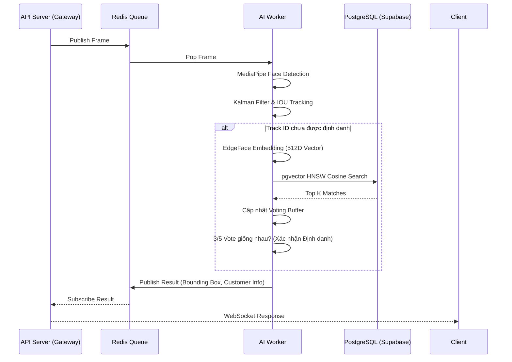

# Luồng Xử lý AI & Tracking (AI Pipeline)

Luồng xử lý AI của Front Door AI được thiết kế để giải quyết bài toán cốt lõi: **Đảm bảo khả năng nhận diện chính xác, theo thời gian thực (Real-time), trong điều kiện ánh sáng và góc mặt thay đổi, mà không làm suy giảm hiệu năng (FPS) của luồng Camera.**

## 1. Phân Phối Tác Vụ Cơ Sở (Message Broker)

Thay vì tích hợp chung luồng AI với API Server, hệ thống tách rời hoàn toàn:
- API Server (FastAPI) nhận các frames liên tục từ WebSocket và đẩy chúng vào Redis Queue (`camera_frames_v2`).
- Một nhóm các **AI Worker (Stateless)** lắng nghe queue này, kéo frame về để phân tích. Sự tách biệt này giúp mở rộng năng lực xử lý (Horizontal Scaling) vô hạn bằng cách chạy nhiều AI Worker song song.

## 2. Các Tầng Xử lý Bên Trong Worker (Processing Layers)

Khi một AI Worker nhận được Frame, quá trình xử lý trải qua các bước sau:

### Bước 1: Face Detection (Phát hiện khuôn mặt)
- Sử dụng **MediaPipe Tasks API** để phát hiện cực nhanh các khuôn mặt trong khung hình.
- Trả về Bounding Box (Tọa độ khuôn mặt) kèm theo Score (Độ tin cậy).
- Bộ lọc cấu hình sẵn sẽ loại bỏ các khuôn mặt quá nhỏ (`MIN_FACE_BBOX_SIZE`) hoặc có độ tin cậy quá thấp (`MIN_DETECTION_SCORE`).

### Bước 2: Object Tracking (Theo dõi Đối tượng liên tục)
Việc trích xuất và nhận diện đặc trưng khuôn mặt liên tục trên từng Frame là tốn kém. Giải pháp tối ưu là áp dụng **Tracking**:
- Mỗi khuôn mặt khi xuất hiện lần đầu được hệ thống cấp một `Track ID` nội bộ (Ví dụ: `T_1234`).
- Sử dụng thuật toán **Kalman Filter** để dự đoán vị trí khuôn mặt ở frame tiếp theo dựa trên quỹ đạo và vận tốc di chuyển.
- Kết hợp với thuật toán **IOU (Intersection Over Union)**, hệ thống ánh xạ khuôn mặt ở frame N với frame N-1.
- Nếu Track ID này đã được định danh thành công ở các frame trước, hệ thống có thể kết luận danh tính ngay lập tức mà không cần phân tích lại đặc trưng.

### Bước 3: Lazy Embedding Extraction (Trích xuất Đặc trưng)
- Nếu Track ID chưa được định danh, AI sẽ trích xuất Vector Embedding 512 chiều từ mô hình **EdgeFace** (`edgeface_s_gamma_05.onnx`).
- Quá trình này được thiết kế theo cơ chế *Lazy* (Chỉ chạy khi thực sự cần thiết và khung hình đủ tiêu chuẩn độ sắc nét/kích thước) nhằm tiết kiệm tài nguyên tính toán.

### Bước 4: So khớp & Multi-frame Voting (Nhận diện)
Để giảm thiểu tỷ lệ nhận diện nhầm (False Positive), hệ thống không bao giờ chốt kết quả chỉ dựa trên 1 khung hình:
- **Vector Search:** Gửi Vector 512 chiều lên PostgreSQL (Supabase). Bảng `customer_embeddings` sử dụng thuật toán **HNSW** của `pgvector` để tìm 3 khuôn mặt tương đồng nhất (`top_k=3`) với tốc độ < 5ms. Truy vấn này tìm kiếm trên toàn bộ tập dữ liệu chung của cả Khách hàng (Customer) lẫn Khách vãng lai (Guest).
- **Cơ chế Bỏ phiếu (Voting):** Kết quả nhận diện của 5 frame gần nhất được đưa vào hàng đợi bỏ phiếu. Chỉ khi 3/5 frame đồng thuận chung một khách hàng (ví dụ: `CUST_001`), hệ thống mới chính thức xác nhận (Resolve) Track ID này thuộc về `CUST_001`.

### Bước 5: Đăng ký Khách Vãng Lai (Guest Registration)
- Nếu một khuôn mặt xuất hiện trong camera quá lâu (vượt qua ngưỡng `GUEST_CREATION_BUFFER_SIZE`) nhưng hệ thống không tìm thấy kết quả trùng khớp trong cơ sở dữ liệu.
- AI Worker tự động khởi tạo một định danh khách hàng mới (`Guest`).
- Vector trung bình (Mean Embedding) của Guest này được lưu theo cơ chế **Dual-write** (lưu song song vào cột `vector(512)` cho `pgvector` và cột `BYTEA` cho dự phòng) một cách bất đồng bộ (Asynchronously) vào Supabase.
- Trên giao diện Frontend, nhân viên có thể xem được lịch sử của Khách Vãng Lai này và tiến hành cập nhật thông tin nếu cần thiết. Hệ thống sẽ gọi API promote guest để tự động đồng bộ (sync) vector của Guest này thành Customer chính thức.

---

## 3. Sơ đồ Luồng Tracking (Tracking Workflow)

