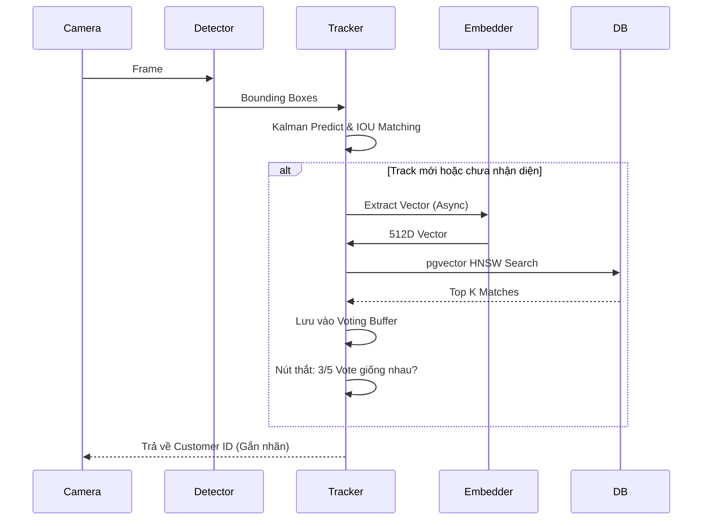

# Luồng Xử lý AI & Tracking (AI Pipeline)

Luồng AI của Front Door AI là trái tim của hệ thống, được thiết kế để giải quyết bài toán: **Làm sao nhận diện chính xác một người đang di chuyển, quay mặt, độ sáng thay đổi, mà không làm giật FPS của Camera?**

## 1. Các Tầng Xử lý (Processing Layers)

### Bước 1: Face Detection (Phát hiện khuôn mặt)
- Sử dụng **MediaPipe Face Detector** (hoặc SCRFD tích hợp trong InsightFace).
- Trả về Bounding Box (Tọa độ khuôn mặt) và Điểm Landmark (Mắt, Mũi, Miệng) kèm theo Score (Độ tin cậy).
- Lọc bỏ các khuôn mặt quá nhỏ (`MIN_FACE_BBOX_SIZE`) hoặc độ tin cậy thấp (`MIN_DETECTION_SCORE`).

### Bước 2: Object Tracking (Theo dõi Đối tượng với Kalman Filter)
Việc nhận diện trên từng Frame là cực kỳ chậm. Giải pháp là **Tracking**:
- Mỗi khuôn mặt được cấp một `Track ID` (VD: `T1`).
- Sử dụng **Kalman Filter** để dự đoán vị trí khuôn mặt ở frame tiếp theo dựa trên vận tốc di chuyển.
- Kết hợp với thuật toán Hungari (Hungarian Algorithm) qua **IOU (Intersection Over Union)** để map khuôn mặt ở frame N với frame N-1.
- Nhờ Tracking, AI biết được khuôn mặt trong frame hiện tại chính là khách hàng đã nhận diện ở frame trước, bỏ qua bước nhận diện lại.

### Bước 3: Quality Check & Lazy Embedding Extraction
- Thuật toán tự đánh giá độ sắc nét, góc xoay của khuôn mặt.
- Nếu đạt chuẩn (`quality_ok = True`), AI spawn một Thread phụ (Asynchronous) để trích xuất Vector Embedding 512 chiều từ model **GhostFaceNet** hoặc **AdaFace**.
- Vector này được thêm vào Buffer của `TrackState`.

### Bước 4: So khớp (Matching) & Multi-frame Voting
Hệ thống không vội vàng kết luận dựa trên 1 frame duy nhất để tránh nhận diện sai (False Positive).
- **HNSW Vector Search:** Gửi Vector 512D lên PostgreSQL (Supabase). Bảng `customer_embeddings` sử dụng thuật toán HNSW của `pgvector` để tìm 3 khuôn mặt gần giống nhất (`top_k=3`) với tốc độ < 2ms.
- **Voting Cơ chế (Bỏ phiếu):** Lưu lại kết quả nhận diện của 5 frame gần nhất. Nếu 3/5 frame cùng nhận diện ra ID `CUST_001`, hệ thống mới chính thức "Chốt" (Resolve) khách hàng này.

### Bước 5: Đăng ký Khách vãng lai (Guest Registration)
- Nếu Track tồn tại quá lâu (vượt `GUEST_CREATION_BUFFER_SIZE`) mà không khớp với bất kỳ ai, hệ thống tự động sinh ra một `GUEST_ID` (VD: `GUEST_default_01_0001`).
- Vector trung bình (Mean Embedding) của Guest này được Insert tạm vào CSDL.
- Trên giao diện Frontend, nhân viên có thể "Promote" (Chuyển đổi) Guest này thành Khách hàng chính thức.

---

## 2. Sơ đồ Luồng Tracking (Tracking Workflow)

## 3. Tự động Học hỏi (Auto Merge / Face Bank Update)
Khi một `Track` ban đầu mờ/đeo kính (được ghi nhận là Guest vectors nội bộ), nhưng sau đó tháo kính và hệ thống nhận diện ra được người dùng, Backend sẽ tự động lấy trung bình cộng các vector mờ/đeo kính đó, **Merge** vào CSDL của người dùng. Việc này giúp hệ thống ngày càng thông minh và nhận ra khách hàng dễ dàng hơn ở các lần sau.
