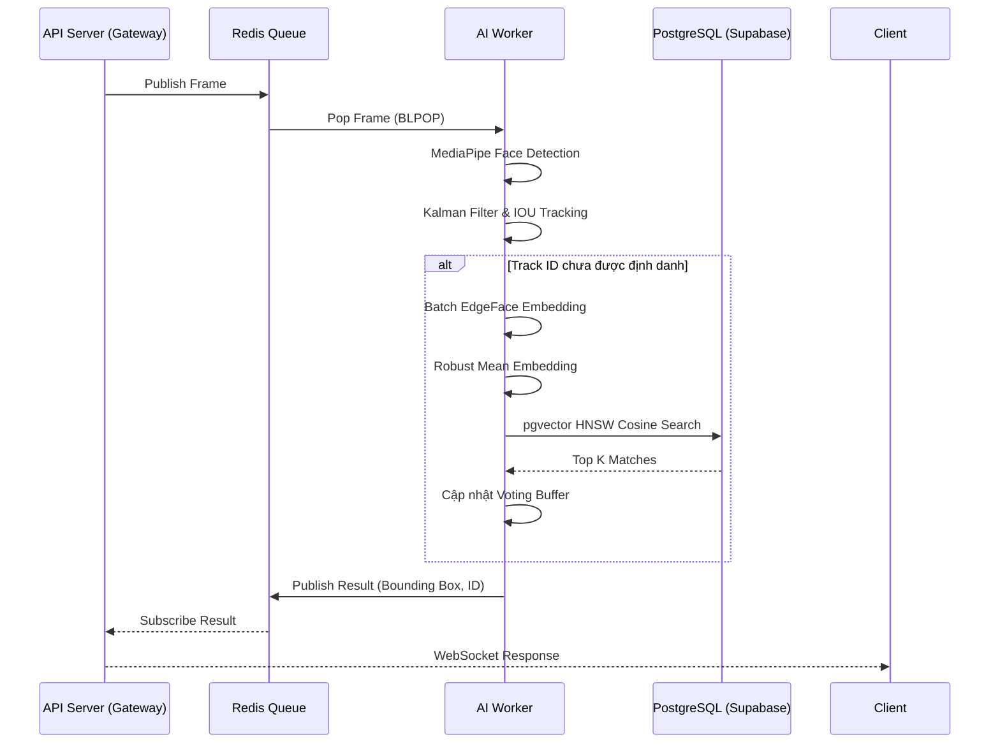

# Luồng Xử lý AI & Tracking (AI Pipeline)

Luồng xử lý AI của Front Door AI được thiết kế để giải quyết bài toán cốt lõi: **Đảm bảo khả năng nhận diện chính xác, theo thời gian thực (Real-time), trong điều kiện ánh sáng và góc mặt thay đổi, mà không làm suy giảm hiệu năng (FPS) của luồng Camera.**

## 1. Phân Phối Tác Vụ Cơ Sở (Message Broker)

Thay vì tích hợp chung luồng AI với API Server, hệ thống tách rời hoàn toàn:
- API Server (FastAPI) nhận các frames liên tục từ WebSocket và đẩy chúng vào Redis Queue (`camera_frames_v2`).
- Một nhóm các **AI Worker (Stateless)** lắng nghe queue này (`BLPOP`), kéo frame về để phân tích. Sự tách biệt này giúp mở rộng năng lực xử lý (Horizontal Scaling) vô hạn bằng cách chạy nhiều AI Worker song song.
- Worker sẽ tự động **Drop (bỏ qua)** các frame bị trễ (delay > 0.5s) để tránh tình trạng thắt nút cổ chai (bottleneck) tích tụ trên hàng đợi.

## 2. Các Tầng Xử lý Bên Trong Worker (Processing Layers)

Khi một AI Worker nhận được Frame, quá trình xử lý trải qua các bước sau thông qua 2 lớp chính: `InsightEmbedder` và `GuestTrackManager`.

### Bước 1: Face Detection (Phát hiện khuôn mặt)
- Sử dụng **MediaPipe Tasks API** tích hợp bên trong `InsightEmbedder` để phát hiện cực nhanh các khuôn mặt trong khung hình.
- Trả về Bounding Box (Tọa độ khuôn mặt), Landmark (Các điểm neo khuôn mặt) kèm theo Score (Độ tin cậy).
- Bộ lọc cấu hình sẵn sẽ loại bỏ các khuôn mặt quá nhỏ (`MIN_FACE_BBOX_SIZE`) hoặc có độ tin cậy quá thấp (`MIN_DETECTION_SCORE`).

### Bước 2: Object Tracking (Theo dõi Đối tượng liên tục)
Việc trích xuất và nhận diện đặc trưng khuôn mặt liên tục trên từng Frame là tốn kém. Giải pháp tối ưu là áp dụng **Tracking**:
- Mỗi khuôn mặt khi xuất hiện lần đầu được hệ thống cấp một `Track ID` nội bộ (Ví dụ: `1`, `2`).
- Sử dụng thuật toán **Kalman Filter** (`KalmanFilterCorner`) để dự đoán vị trí 4 góc của bounding box ở frame tiếp theo dựa trên vận tốc di chuyển.
- Kết hợp với thuật toán **IOU (Intersection Over Union)** thông qua Hungarian Algorithm (Linear Sum Assignment), hệ thống ánh xạ khuôn mặt ở frame N với frame N-1 một cách tối ưu nhất.
- Nếu Track ID này đã được định danh thành công ở các frame trước, hệ thống có thể tái sử dụng kết luận danh tính ngay lập tức.

### Bước 3: Batch Lazy Embedding (Trích xuất Đặc trưng theo Lô)
- Nếu Track ID chưa được định danh, AI sẽ trích xuất Vector Embedding 512 chiều từ mô hình **EdgeFace** (ưu tiên dùng định dạng `int8`, fallback sang `float32`).
- Worker thu thập toàn bộ khuôn mặt đạt chuẩn trên một frame và thực hiện tính toán đặc trưng theo lô (`get_batch_embeddings`) để tận dụng sức mạnh xử lý song song của ONNX Runtime.

### Bước 4: So khớp & Multi-frame Voting (Nhận diện)
Để giảm thiểu tỷ lệ nhận diện nhầm (False Positive), hệ thống không bao giờ chốt kết quả chỉ dựa trên 1 khung hình:
- **Vector Search:** Gửi Vector 512 chiều lên PostgreSQL (Supabase). Bảng `customer_embeddings` sử dụng thuật toán **HNSW** của `pgvector` để tìm 3 khuôn mặt tương đồng nhất (`top_k=3`) với tốc độ siêu tốc.
- **Robust Mean Embedding:** Nếu một Track tồn tại qua nhiều frame, hệ thống sẽ tính vector trung bình (Mean Embedding) để mang đi so sánh, nhưng có đi kèm thuật toán loại bỏ nhiễu (outlier rejection). Các Vector quá sai lệch sẽ bị loại bỏ để tránh tạo ra "Frankenstein embedding" khi hai người đứng quá sát nhau làm nhiễu track.
- **Cơ chế Bỏ phiếu (Voting):** Kết quả nhận diện của các frame gần nhất được đưa vào hàng đợi bỏ phiếu. Chỉ khi vượt qua ngưỡng đồng thuận, hệ thống mới chính thức xác nhận (Resolve) Track ID đó.

### Bước 5: Đăng ký Khách Vãng Lai (Guest Registration)
- Nếu một khuôn mặt xuất hiện trong camera quá lâu (vượt qua ngưỡng `GUEST_CREATION_BUFFER_SIZE`) nhưng hệ thống không tìm thấy kết quả trùng khớp trong DB (với ngưỡng similarity > `NEW_GUEST_DEBOUNCE_SIMILARITY`).
- Lớp `GuestTrackManager` sẽ Debounce (Chống spam) dựa trên thời gian thực `NEW_GUEST_DEBOUNCE_SECONDS` để đảm bảo hệ thống DB đã kịp phản hồi.
- AI Worker tự động khởi tạo một định danh khách hàng mới (`GUEST_...`).
- Vector đặc trưng của Guest này được lưu theo cơ chế **Dual-write** (lưu song song vào cột `vector(512)` và `BYTEA`).
- Trên giao diện Frontend, nhân viên có thể xem được lịch sử của Khách Vãng Lai này và tiến hành cập nhật thông tin thành Customer (Promote Guest).

---

## 3. Sơ đồ Luồng Tracking (Tracking Workflow)

