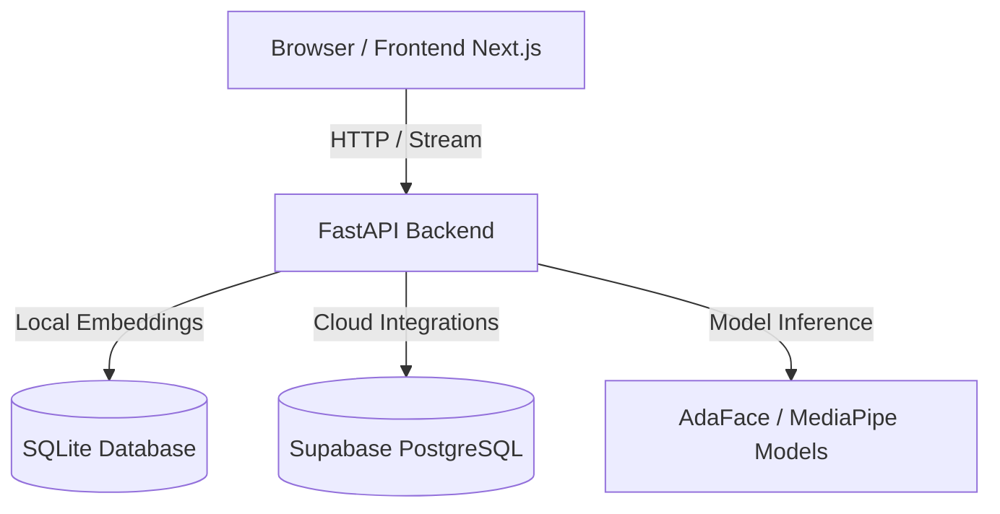

# Project Context: Face Recognition — Front Door AI

## Overview
Front Door AI is a real-time face recognition and attendance tracking system. It uses a browser-based camera feed (or local camera capture) to detect and recognize multiple people concurrently, display their profiles, track new/unrecognized guests, and manage check-ins/attendance logs.

---

## Technical Architecture

### 1. Frontend: Next.js (App Router)
* **Framework:** Next.js (React 18), Tailwind CSS, Lucide React.
* **Camera Capture:** Accesses browser webcam (`getUserMedia`), captures frames, and interacts with backend APIs.
* **Overlay Canvas:** Receives coordinates (`bbox`) from the backend and draws colored overlays and tracking boxes on the live camera viewport.

### 2. Backend: FastAPI (Python)
* **Framework:** FastAPI, Uvicorn, OpenCV (`cv2`), NumPy.
* **AI Models:**
  * **Face Detection:** MediaPipe Face Mesh / Face Landmarker (`face_landmarker.task`).
  * **Face Recognition:** ONNX models (AdaFace IR50 `adaface_ir50.onnx` or GhostFace).
* **Face Tracking & Recognition Engine:**
  * `GuestTrackManager`: Manages tracks of faces detected in the video stream using Intersection over Union (IoU) tracking.
  * *Lazy Embedding Computation:* Minimizes CPU overhead by only generating embeddings when quality conditions are met and tracking is stable.
  * Supports *Guest Promotion*: Unrecognized faces get a temporary ID (`GUEST_*` or `T*`), which can be promoted to a permanent profile ID when registered.

### 3. Databases
The backend is database-agnostic via configuration:
* **SQLite (Default / Local):** Saves profiles and attendance logs locally in `backend/data/database/production.db`.
* **Supabase (PostgreSQL / Cloud):** Connects to a cloud Supabase PostgreSQL instance if environment variables `USE_SUPABASE=true` and database credentials are provided.

---

## Core API Endpoints

* `GET /test` — Verify if the FastAPI backend is running.
* `POST /api/process_frame` — Accepts base64 encoded frames from the browser camera.
* `GET /api/customers_overview` — Returns active recognized customer profiles, bounding box coordinate scales, and tracking statuses.
* `PUT /api/customer_profile` — Creates or updates a customer profile (promoting a temporary Guest ID to a permanent ID).
* `GET /api/customers` — Fetches list of all registered customers.
* `POST /api/check_in/{customer_id}` — Triggers a manual or automatic check-in event (with configurable cooldown timers).

---

## Technical Constraints & Requirements

* **Performance:** Processing frames is CPU/GPU heavy. Frame sampling (`PROCESS_EVERY_N_FRAMES = 3`) and asynchronous background processing threads are utilized.
* **Lighting/Quality:** Embeddings are only calculated if the face quality is high enough (`GUEST_MIN_DETECTION_SCORE = 0.85` and `GUEST_MIN_FACE_BBOX_SIZE = 100`).
* **Environment:** Works on local environments (Windows/macOS/Linux) and supports server-side deployment on AWS EC2 behind an Nginx proxy.
