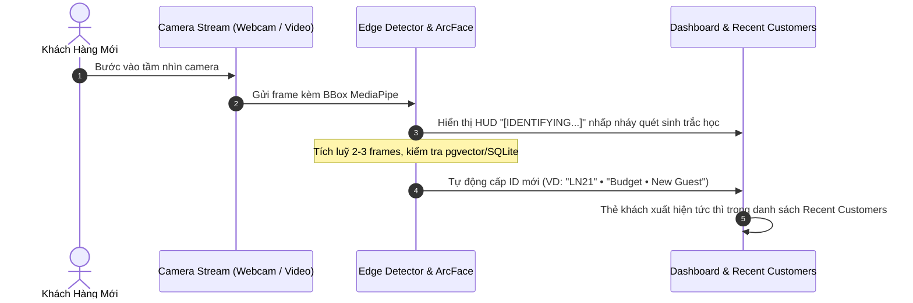
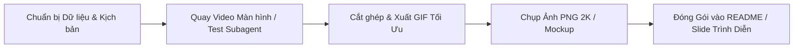

# 🎬 Kế Hoạch Sản Xuất GIF & Bộ Ảnh Showcase Hệ Thống CustomerLens

> **Mục tiêu**: Xây dựng bộ tư liệu thị giác (GIFs động & Screenshots độ phân giải cao) trực quan, ấn tượng và thuyết phục người xem về năng lực AI nhận diện khuôn mặt thời gian thực của CustomerLens trong bán lẻ và giám sát thông minh.

---

## 📌 Tổng Quan Bộ Tư Liệu (Media Kit)

| STT | Tên Tư Liệu | Thể Loại | Tính Năng Nổi Bật Được Chứng Minh | Thời Lượng / Kích Thước |
|:---:|:---|:---:|:---|:---:|
| **1** | **Hero GIF: Auto Guest Onboarding** | GIF Động | Phát hiện khách lạ & tự cấp ID duy nhất trong 0.75s | 5 - 7 giây (~3MB) |
| **2** | **Feature GIF: 1-Click Profile Editing** | GIF Động | Click thẳng vào BBox trên mặt khách để mở form nhập thông tin | 6 - 8 giây (~4MB) |
| **3** | **Feature GIF: Real-time Re-ID & VIP Alert** | GIF Động | Nhận diện lại tức thì khi khách quay lại với thông tin & hạng VIP | 5 - 7 giây (~3MB) |
| **4** | **Overview GIF: Multi-Camera Grid** | GIF Động | Quản lý đa luồng, lưới nhiều camera đồng thời, ghép nối thiết bị | 6 - 8 giây (~4MB) |
| **5** | **Showcase Screenshots (Bộ 5 ảnh)** | PNG 4K/2K | Toàn cảnh Dashboard, HUD BBox, Lịch sử check-in, Quản lý đa cam | 5 ảnh sắc nét |

---

## 🎞️ Kịch Bản Chi Tiết Từng GIF (Storyboards)

### 1. GIF 1: Cấp ID Tự Động Cho Khách Lạ (Zero-Shot Guest Enrollment)
*Chứng minh: Hệ thống phát hiện người mới ngay lập tức mà không cần đăng ký trước.*



* **Thao tác thực hiện khi quay**:
  1. Mở tab **Live Camera Stream** (chọn Webcam hoặc video clip người mới).
  2. Khách xuất hiện: BBox viền vàng công nghệ cao hiện nhãn `IDENTIFYING...`.
  3. Sau 0.5s: BBox và HUD đổi trạng thái -> Cấp mã `LN21`, phân khúc `Budget • New Guest (LN)`.
  4. Camera panel bên phải trượt thêm thẻ khách hàng mới có ảnh avatar crop cận mặt.
* **Thời điểm cắt GIF**: Từ lúc người bước vào đến khi thẻ khách hiện ra ở cột Recent Customers (tổng 5s).

---

### 2. GIF 2: Chỉnh Sửa Hồ Sơ Khách Trực Tiếp Từ Khung BBox (1-Click Edit)
*Chứng minh: Thao tác cực nhanh, không cần tìm kiếm hay bấm nút rườm rà.*

* **Kịch bản**:
  1. Di chuột vào khuôn mặt đang có BBox (hiện tooltip tinh tế: *"✓ Nhấn vào để chỉnh sửa"*).
  2. Click chuột trực tiếp vào khung mặt khách hàng.
  3. Modal popup **"Cập nhật hồ sơ khách hàng"** mở mượt mà ngay giữa màn hình:
     - Avatar của khách được tự động trích xuất sắc nét từ camera.
     - Nhập nhanh: Tên: `Nguyễn Văn A` (hoặc tên người nổi tiếng như `Bill Clinton`).
     - Chọn phân hạng: `VIP Member` (Hạng Vàng / Kim Cương).
     - Nhập số điện thoại: `0901 234 567`.
  4. Nhấn nút **"Lưu hồ sơ"** -> Modal đóng, thông báo Toast thành công.
* **Thời điểm cắt GIF**: Từ cú click vào mặt khách -> Nhập thông tin -> Bấm Lưu (tổng 6s).

---

### 3. GIF 3: Tái Nhận Diện Chuẩn Xác (Re-Identification & VIP Experience)
*Chứng minh: Khách quay lại sau đó được nhận diện đúng 100% kèm danh hiệu VIP.*

* **Kịch bản**:
  1. Khách bước ra khỏi khung hình một vài giây (hoặc chuyển sang clip video thứ 2 của cùng người đó).
  2. Khách quay trở lại trước camera:
  3. Ngay frame đầu tiên (< 0.2s):
     - BBox lập tức nhận diện đúng tên: `Nguyễn Văn A` / `Bill Clinton`.
     - Nhãn hạng thành viên `⭐ VIP`.
     - HUD Card hiển thị: `Visits: 2 visits`, Lịch sử chi tiêu, Segment Code `LC / VN / VIP`.
     - Cột Recent Customers cập nhật giờ ghé mới nhất.
* **Thời điểm cắt GIF**: Khách bước vào -> BBox bắt ngay lập tức với tên VIP (tổng 5s).

---

### 4. GIF 4: Giám Sát Đa Luồng & Quản Lý Camera (Multi-Camera Grid Management)
*Chứng minh: Năng lực mở rộng hệ thống nhiều chi nhánh / nhiều góc quay.*

* **Kịch bản**:
  1. Người dùng bấm vào menu **Camera** trên thanh điều hướng bên trái.
  2. Giao diện mở ra lưới **Camera Grid (2x2 hoặc 3x3)**:
     - **Camera 1**: Cửa ra vào chính (Integrated Webcam - Live).
     - **Camera 2**: Sảnh đón khách (CCTV Phố đi bộ test_video.mp4 - Live).
     - **Camera 3**: Quầy thu ngân / VIP Lounge (Stream video người nổi tiếng - Live).
  3. Mỗi camera hiển thị:
     - Badge trạng thái `🟢 LIVE` nhấp nháy.
     - Số lượng khách đang có mặt trong khung hình (`In view: 2`).
     - Tên camera có thể đổi trực tiếp (Inline Rename).
  4. Click nút **Phóng to toàn màn hình (Maximize)** trên 1 camera để soi cận cảnh, rồi thu nhỏ lại lưới tổng quan.
* **Thời điểm cắt GIF**: Lướt qua lưới camera đa luồng -> Phóng to 1 camera -> Thu nhỏ (tổng 7s).

---

## 📸 Danh Sách 5 Ảnh Chụp Màn Hình Trưng Bày (Showcase Screenshots)

### 🖼️ Ảnh 1: Executive Dashboard & Store Intelligence
* **Trang**: `/` (Tab Executive Overview).
* **Nội dung hiển thị**:
  - 4 thẻ KPI chỉ số hàng đầu: Tổng lượt khách hôm nay, Tỷ lệ khách quay lại (Retention Rate), Khách VIP đang có mặt, Doanh thu ước tính.
  - Biểu đồ phân bố phân khúc khách hàng (RFM Segments: VIP, Regular, New Guest, At-Risk).
  - Biểu đồ lưu lượng khách theo khung giờ trong ngày (Peak hours heatmap).
* **Mục đích**: Cho thấy hệ thống không chỉ nhận diện mặt mà còn là nền tảng quản trị kinh doanh thông minh.

### 🖼️ Ảnh 2: Live AI HUD Face Tracking (Công Nghệ Cao)
* **Trang**: `/` (Tab Live Camera Stream).
* **Nội dung hiển thị**:
  - Khung hình camera trực tiếp với khuôn mặt người dùng/khách hàng.
  - HUD Card Cyberpunk công nghệ cao hiển thị: Tên khách, Mã phân khúc, Tỷ lệ nhận diện (Similarity Score), Độ sắc nét, Lịch sử ghé thăm.
  - Bảng "Recent Customers" bên phải có danh sách các khách vừa bước vào với avatar sắc nét.
* **Mục đích**: Gây ấn tượng thị giác mạnh mẽ (WOW effect) về độ xịn sò của giao diện công nghệ AI.

### 🖼️ Ảnh 3: In-Stream Profile Modal (Tương Tác Trực Tiếp)
* **Trang**: `/` khi vừa click vào BBox trên mặt khách.
* **Nội dung hiển thị**:
  - Nền mờ kính mờ (Glassmorphism backdrop).
  - Modal chỉnh sửa thông tin hiển thị ảnh trích xuất của khuôn mặt khách.
  - Các trường dữ liệu: Tên, SĐT, Email, Phân hạng thành viên, Ghi chú sở thích/thói quen của khách.
* **Mục đích**: Chứng minh tính tiện dụng cho nhân viên bán hàng/tiếp tân khi cập nhật thông tin khách tại quầy.

### 🖼️ Ảnh 4: Multi-Camera Operations Center
* **Trang**: `/camera`.
* **Nội dung hiển thị**:
  - Lưới hiển thị 4 camera đồng thời đang phát trực tiếp.
  - Menu ghép nối camera mới bằng Pairing Code (6 chữ số).
  - Nút chuyển đổi nhanh giữa các chi nhánh (Downtown Branch, Mall Branch).
* **Mục đích**: Chứng minh kiến trúc phân tán, hỗ trợ triển khai quy mô lớn cho chuỗi cửa hàng.

### 🖼️ Ảnh 5: Customer Journey & Check-in Timeline
* **Trang**: `/history` hoặc `/customers`.
* **Nội dung hiển thị**:
  - Dòng thời gian các lần khách ghé thăm cửa hàng (Timestamp, Camera ghi nhận, Khoảng thời gian lưu lại).
  - Hồ sơ khách hàng chi tiết với biểu đồ tần suất ghé thăm và phân loại nhóm chi tiêu.
* **Mục đích**: Khẳng định giá trị lưu trữ và phân tích dữ liệu dài hạn (Data Analytics & CRM Integration).

---

## 🛠️ Quy Trình Thực Hiện & Công Cụ Khuyên Dùng



### 1. Chuẩn bị dữ liệu mẫu (Demo Data):
- **Khách 1 (Người thật qua Webcam)**: Để demo tính năng nhận diện thực tế tức thì, click sửa thông tin.
- **Khách 2 (Celebrity Video YTF)**: Dùng video `Bill_Clinton_0.mp4` để đăng ký -> đổi tên thành `Bill Clinton (VIP)` -> Dùng `Bill_Clinton_1.mp4` để chứng minh Re-ID tự động chính xác tuyệt đối.

### 2. Công cụ ghi hình & tạo GIF chất lượng cao:
- **ScreenToGif** (Miễn phí, mã nguồn mở, cực nhẹ cho Windows):
  - Tải nhanh: `winget install -e --id NickeManarin.ScreenToGif`
  - Ưu điểm: Cho phép chọn đúng khung hình của trình duyệt, cắt frame thừa, thêm hiệu ứng phóng to con trỏ chuột (Mouse click highlight), xuất GIF nén bảng màu 256 màu cực mượt dung lượng < 3MB.
- **Ffmpeg** (Tối ưu GIF mượt & nhẹ):
  ```bash
  ffmpeg -i recording.mp4 -vf "fps=15,scale=960:-1:flags=lanczos,split[s0][s1];[s0]palettegen[p];[s1][p]paletteuse" demo_customerlens.gif
  ```
