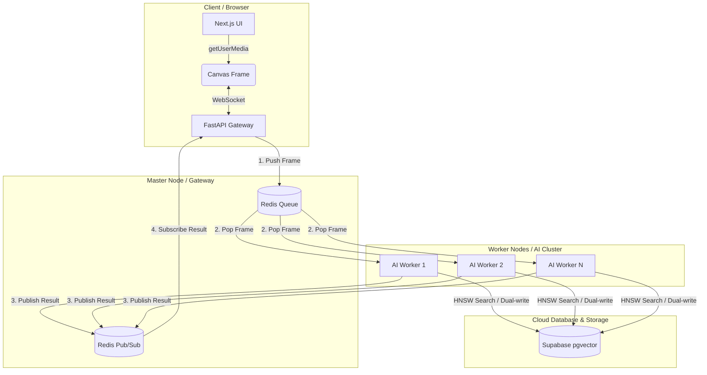

# Kiến trúc Hệ thống (System Architecture)

Dự án Front Door AI được thiết kế với kiến trúc **Event-driven, Asynchronous & Distributed**. Sự tách biệt hoàn toàn giữa Frontend, Backend API Gateway và các AI Worker Stateless giúp hệ thống đảm bảo FPS (Frames Per Second) cao ngay cả khi lượng người dùng tăng đột biến.

## 1. Cấu trúc Tổng thể (High-level Architecture)

Hệ thống bao gồm 4 tầng (tiers) chính:

1. **Client Tier (Frontend):** 
   - Xây dựng bằng **Next.js 14**.
   - Truy cập Camera thiết bị thông qua WebRTC / `getUserMedia`.
   - Nén ảnh và stream trực tiếp dữ liệu thô (Raw Binary) qua **WebSocket**.
2. **Gateway Tier (FastAPI Backend):**
   - Đóng vai trò là điểm cuối (endpoint) giao tiếp với người dùng.
   - Tiếp nhận luồng WebSocket, bóc tách frame và đẩy (publish) vào hàng đợi (queue) thông qua **Redis**.
   - Chờ nhận kết quả từ Redis (qua cơ chế Pub/Sub) và truyền lại cho Frontend.
3. **Worker Tier (AI Processing):**
   - Là các tiến trình (containers) độc lập, hoàn toàn **Stateless** (không lưu trạng thái).
   - Lắng nghe hàng đợi từ Redis, kéo frame về, xử lý phát hiện (Detection), theo dõi (Tracking) và trích xuất vector (Embedding).
   - Đẩy kết quả trở lại một kênh (channel) đặc thù của `connection_id` tương ứng trên Redis.
4. **Data Tier (Database & Cloud Storage):**
   - **PostgreSQL (Supabase):** Kết hợp `pgvector` cho việc tìm kiếm HNSW siêu tốc (Vector Similarity Search) áp dụng cho cả Guest và Customer.
   - **Supabase Storage:** Lưu trữ ảnh đại diện của khách hàng trên Cloud CDN (với cơ chế Fallback lưu tại Local nếu mất kết nối).

---

## 2. Luồng Dữ liệu (Data Flow) & Scalability

### 2.1. Phân phối tác vụ qua Redis Pub/Sub
Hệ thống sử dụng Redis làm Message Broker trung tâm:
- API Server nhận frame từ WebSocket và đẩy vào Redis list/queue (ví dụ: `camera_frames_v2`).
- Bất kỳ AI Worker nào đang rảnh (Idle) sẽ bốc (pop) frame từ queue này để xử lý.
- Cơ chế này cho phép **Horizontal Scaling** vô hạn: Càng nhiều camera kết nối, quản trị viên chỉ cần bật thêm (scale up) AI Worker Node. API Server không bao giờ bị nghẽn CPU.

### 2.2. Streaming qua WebSocket & Session Isolation
Hệ thống loại bỏ hoàn toàn HTTP Polling cũ kỹ, thay bằng kết nối WebSocket bền vững (`/ws/{camera_id}` hoặc `/ws/observe/{camera_id}`).
- **Session Isolation:** Mặc dù endpoint sử dụng chung `camera_id` tĩnh, nhưng ở phía backend mỗi khi có Client/Tab Trình duyệt kết nối, hệ thống sẽ tự động sinh ra một `connection_id` ngẫu nhiên duy nhất (VD: `conn_uuid...`). Luồng camera và kết quả bounding box của Tab nào sẽ chỉ được gửi về đúng Tab đó thông qua `connection_id` này, đảm bảo tính riêng tư và tránh xung đột khi nhiều người quản trị mở nhiều camera cùng lúc.
- Khi AI Worker xử lý xong, nó publish kết quả vào kênh Redis riêng của session đó (`worker_results_{connection_id}`). API Server đang subscribe kênh này sẽ nhận kết quả và forward về đúng Client.

---

## 3. Sơ đồ Kiến trúc (Architecture Diagram)

## 4. Tối ưu hóa Hiệu năng & Vận hành

- **Connection Pool:** Cả API Server và AI Worker đều sử dụng `ThreadedConnectionPool` của `psycopg2` (min=2, max=10) để tái sử dụng kết nối Database, tránh tình trạng thắt nút cổ chai (bottleneck) khi truy vấn liên tục.
- **Track Lifecycle Caching:** Dữ liệu hồ sơ khách hàng chỉ được truy vấn **1 lần duy nhất** khi khuôn mặt xuất hiện. AI Worker lưu vào RAM bộ cache của những người đang trong khung hình (`GuestTrackManager`), giảm tải 99% cho Database.
- **Lazy Embedding & Throttling:** Quá trình trích xuất vector đặc trưng 512D (thao tác tốn kém nhất) chỉ xảy ra ở một số frame nhất định khi đủ điều kiện kích thước, và được chạy dưới dạng Background Thread bên trong AI Worker.
- **Centralized Logging:** Mọi log của hệ thống (API Gateway, Redis, AI Worker) được quy chuẩn hóa cấu trúc qua module `logger.py` (`[HH:MM:SS] LEVEL module: message`), giúp dễ dàng giám sát trên môi trường Production.
